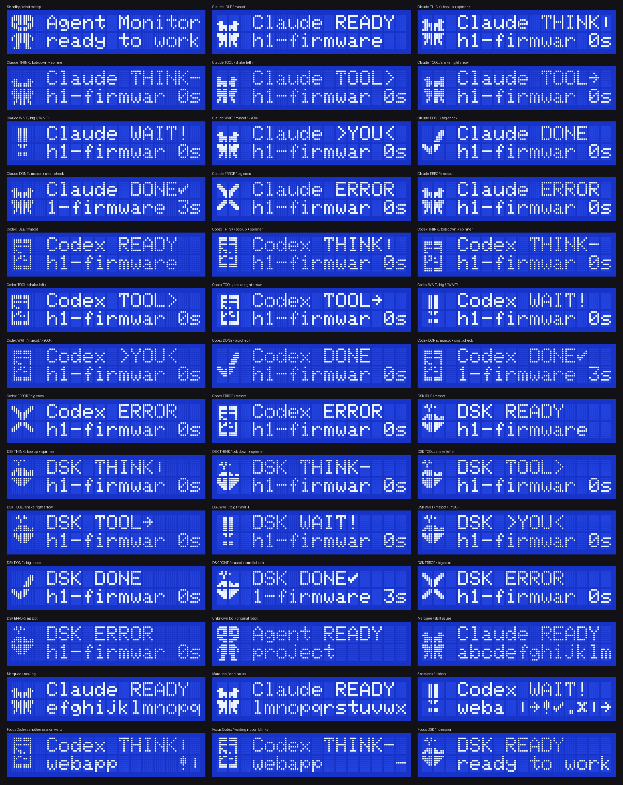

# Agent 状态屏（1602 字符屏版）v0.1

ESP32 + 1602A，通过 USB 显示 Claude Code、Codex、DeepSeek harness 的工具、状态和项目名。优先让需要你处理的会话可见，也能跟随电脑前台窗口。



这张图由实际的 `ui.py` 在电脑上运行生成；字母使用近似的 5×7 字库，精灵和小图标使用固件的真实点阵。实物的对比度、观看距离和动画仍需上板确认。

## 屏幕布局

```text
[精灵上半] Claude THINK[转圈]
[精灵下半] project      12s
```

精灵占左侧 2×2 个字符格，合起来是 10×16 像素。工具名为 `Claude`、`Codex`、`DSK`；其它前缀显示 `Agent`，保留原来的机器人。三个工具分别使用小螃蟹、带 `>_` 提示符的终端、喷水鲸鱼。

第二行右侧：有两个及以上会话时，每个会话一个小图标，按加入顺序排列；只有一个会话时显示当前状态持续时间（`12s`、`5m`、`2h`），空闲不显示时间。项目名最多 24 个可显示字符；空间不足时往返滚动，每 400 毫秒一格，两端各暂停 2 秒。

| 状态 | 第一行 | 左侧精灵和提示 |
|---|---|---|
| `idle` | `READY` | 吉祥物静止，每 5 秒短暂切换一帧 150 毫秒 |
| `think` | `THINK` + 转圈 | 每 600 毫秒上下浮动 1 像素 |
| `tool` | `TOOL` + `>` / 右箭头 | 每 200 毫秒左右晃动 1 像素 |
| `wait` | `WAIT!` / `>YOU<` | 大叹号和吉祥物每 400 毫秒交替，板上 LED 闪烁 |
| `done` | `DONE` | 前 3 秒为大对勾，之后为吉祥物和小对勾 |
| `error` | `ERROR` | 大叉和吉祥物每 500 毫秒交替，LED 闪烁 |

没有会话且没有焦点时，显示闭眼机器人、`Agent Monitor` 和 `ready to work`。

## 会话和焦点

最多保留 8 个会话。没有手动焦点时的优先级为：等你 > 出错 > 刚完成（5 秒内）> 跑工具 > 思考 > 完成 > 空闲；同级会话每 3 秒轮换。容量满时，只淘汰最久没更新的空闲或完成会话；其它会话都忙时返回 `err set: full`。

无新消息的会话自动撤下：空闲或完成 15 分钟、出错 1 小时、思考或跑工具 3 小时、等你 12 小时。重复上报相同状态会续期，但不重置状态持续时间。

```text
focus cc-abcdef    固定显示完整会话 key
focus cc           显示最近更新的 Claude 会话（也支持 cx、ds）
focus -            恢复自动优先级
```

回复为 `ok focus <target>`。焦点自最后一次发送起保留 60 秒，电脑监视程序每 20 秒续期。被聚焦的工具没有会话时显示该工具吉祥物、`<tool> READY` 和 `ready to work`。焦点不会隐藏其它会话的求助：小图标继续闪烁，LED 也会闪。

串口仍为 115200，每行一条命令；兼容 `set <key> <state> [name]`、`end <key>`、`clear`、`list`、`ping`、`dump`。`ping` 报告版本 `0.1`。`clear` 清空会话，焦点用 `focus -` 单独解除。坏命令返回 `err`，过长的整行丢弃后继续处理下一行。屏幕每 5 分钟重新初始化并恢复图案。

## 硬件

经典 ESP32 开发板（CH340，USB 同时供电和传数据）+ 1602A 字符屏，HD44780、A00 字库、4 线模式，MicroPython 1.28：

| 屏 | ESP32 | 屏 | ESP32 |
|---|---|---|---|
| VSS | GND | D4 | GPIO 16 |
| VDD | 5V | D5 | GPIO 17 |
| V0 | 电位器中间脚 | D6 | GPIO 25 |
| RS | GPIO 21 | D7 | GPIO 26 |
| RW | GND | A | 5V（串 220Ω） |
| E | GPIO 22 | K | GND |

板上 LED 使用 GPIO 2。8 个 CGRAM 槽分配：0–3 为大精灵，4 为两帧等待图标，5 为对勾，6 为叉，7 为转圈。仅在点阵字节确实变化时写入。像素源图保存在 `ui.py` 的 `ART` 中，可直接编辑 16 行、每行 10 个 `#` / `.`。

## 文件与电脑端

| 文件 | 作用 |
|---|---|
| `lcd1602/main.py` | 硬件初始化、串口循环和可跨时钟回绕的毫秒累计 |
| `lcd1602/ui.py` | 可在 CPython 测试的会话、命令、布局和动画逻辑 |
| `lcd1602/lcd1602.py` | LCD 驱动 |
| `pc/agent_lcd.py` | 钩子、串口发送、自检、演示；保证统一 daemon 启动 |
| `pc/daemon.py` | 单进程合并 DeepSeek 日志和前台窗口监视，绑定 `127.0.0.1:47613` 保证单实例 |
| `pc/dsh_watch.py` | DeepSeek 压缩日志解析与 `Watcher.tick()`；旧入口仍能运行统一 daemon |
| `pc/preview.py` | 从板子读取画面；`sheet` 和离线模拟共用 42 个场景 |
| `pc/sim.py` | 假 LCD 离线运行 UI，生成 `preview-sim.png` |
| `pc/test_ui.py`、`pc/test_daemon.py`、`pc/test_pc.py` | 纯断言离线测试，外部访问均使用替身 |
| `pc/install.py`、`pc/upload.py` | 安装钩子、上传固件 |

统一监视程序每 300 毫秒查询前台窗口，焦点目标改变时发送命令，每 20 秒发送心跳。按进程名识别 Claude、DeepSeek Harness、ChatGPT/Codex；DeepSeek 可通过日志中的 `session/title` 精确匹配会话。终端或编辑器先匹配板上项目名（每次前台窗口切换最多查询一次 `list`，同一窗口更新标题时复用列表），再匹配标题中的 `claude` / `codex`；其它窗口解除焦点。可编辑的映射表在 `daemon.py` 顶部。

Claude Code 和 Codex 继续使用原有钩子。DeepSeek 没有上报接口，运行时只读其会话日志。即使没有安装 DeepSeek，下一次钩子事件也会拉起统一 daemon，用于跟随前台窗口。原有 `python pc/dsh_watch.py -v` 入口继续可用。

以下命令从工程根目录运行，`python` 指 `D:\conda\miniconda3\python.exe`：

```text
python pc/test_ui.py
python pc/test_daemon.py
python pc/test_pc.py
python pc/sim.py
```

下面这些由使用者连接硬件后运行（本次软件实现未运行）：

```text
python pc/upload.py COM4 lcd1602/lcd1602.py lcd1602/ui.py lcd1602/main.py
python pc/agent_lcd.py doctor
python pc/agent_lcd.py demo
python pc/agent_lcd.py send "focus cx"
python pc/daemon.py -v
python pc/preview.py now lcd1602/preview.png
python pc/preview.py sheet lcd1602/preview-board.png
```

`doctor` 报告板子、钩子和统一 daemon；`demo` 演示三个工具的全部状态和焦点切换。上传前须让电脑端停止占用串口。`preview.py sheet` 和 `demo` 都会清空已有会话。

## 宏键盘（AgentDeck v0 USB）

AgentDeck 的 `run`、`learn` 默认 `--backend auto`：用已安装的 `pyusb`、`libusb-package` 尝试打开 `4132:2107` 的 **接口 0（键盘）**，直接读取 interrupt IN 报文。接口 0 改用 WinUSB 后，Windows 不再把它当键盘，原快捷键不会输入前台窗口。只 claim/release 接口 0，不重设整个设备配置，不打开未知的 `0xFF00` 厂商接口，其它接口驱动保持原样。

USB 打不开时，`auto` 查询当前在场设备接口 0 的驱动：只有明确为 HidUsb 才回退到 Windows Raw Input，并打印 Zadig 提示及 **“宏键盘按键会漏到窗口”**；WinUSB、设备未插入或无法确认驱动时都保留 USB 后端，每 2 秒重试，恢复连接后无需重启。Raw Input 只观察设备输入、按映射分发动作，不隔离系统键盘事件；根据设备句柄核对 VID/PID 后才分发，Ace 68（VID_3837）等其它键盘不执行 deck 动作。强制 `--backend usb` 不回退，打不开或拔出设备也每 2 秒重试。读取超时 100 ms，超时本身不会重新连接。

### 用 Zadig 更换接口 0 驱动

以下操作由使用者执行：

1. 打开 [Zadig](https://zadig.akeo.ie/)，选择 **Options → List All Devices**。
2. 确认 **USB ID `4132 2107`**，选 **Interface 0（键盘）**。只替换此接口，保留其它接口和其它键盘的驱动。
3. 目标驱动选 **WinUSB**，点击 **Replace Driver**，等待完成后运行 USB 命令。
4. 恢复时，在设备管理器找到该接口，选 **卸载设备**，勾选 **删除此设备的驱动程序**（新版可能叫“尝试删除此设备的驱动程序”），完成后拔插宏键盘，让 Windows 重装 HID 键盘驱动。

从工程根目录运行，`python` 指 `D:\conda\miniconda3\python.exe`：

```text
python pc/deck.py learn --backend usb
python pc/deck.py run --backend usb -v
python pc/deck.py run -v
python pc/deck.py run --backend rawinput -v
python pc/deck.py learn --backend rawinput
python pc/deck.py run --map pc/deck_map.json --backend usb -v
python pc/daemon.py --deck -v
python pc/test_deck.py
python pc/test_deck_keymap.py
python pc/test_deck_usb.py
python research/smoke_deck_usb.py
```

`run`、`learn` 均接受 `--backend auto|usb|rawinput`，默认 `auto`。`learn` 只打印首次按下的键名和报文信息，不分发动作；USB 输出 `hid:0x08`、`ctrl+hid:0x1D`，Raw Input 输出 `vk:0x45`、`ctrl+vk:0x5A`、`scan:0x0012:0`。按 Ctrl+C 正常退出。USB 冒烟脚本运行 `run --backend usb -v` 约 3 秒后请求正常退出，保存 `research/deck-usb-smoke.log/json`；当前未换驱动时应出现 Zadig 提示。该检查不证明换驱动后的真实按键效果。

低级钩子独占模式**默认关闭**，旧 `--no-exclusive` 仍接受。只有显式运行 `run --backend rawinput --exclusive` 才启用保留的实验代码；`daemon.py --deck` 使用默认 auto 后端及关闭的钩子。**实测该方案无效**：`WH_KEYBOARD_LL` 先于 Raw Input；吞键会使 Windows 不再生成 `WM_INPUT`，钩子拿不到判定来源的设备信息，等待 Raw Input 不能解决投递顺序。因此不能用它保证宏键盘原键不进入窗口。原 `research/smoke_deck_exclusive.py` 是历史钩子测试，不属于 USB 验收。

`probe` 仍使用 `hidapi` 只读列出 VID_4132 的 HID 接口，只对 PID_2107、usage page `0xFF60`、usage `0x61`（QMK 标准）或 `0x01` 的接口发送 VIA 读取命令：`0x01` 协议版本、`0x11` 层数、`0x12` keymap。当前厂商接口为 `0xFF00/0x01`，协议未知，不会打开它或发送报文。程序不自动改键、写配置或切换引导模式。

标准 VIA 读取命令不提供矩阵行列，尺寸来自[键盘定义文件](https://caniusevia.com/docs/specification/#matrix)。有标准 VIA 接口时可用已知尺寸 `python pc/deck.py probe --rows 2 --cols 3`，或 `python pc/deck.py probe --definition path/to/keyboard.json`；示例尺寸需替换成实际定义。有效尺寸会读取全部层；无尺寸时只读协议版本、层数，不猜行列。

当前使用出厂 Photoshop 快捷键，不需要改成 F13–F24。旧 F13–F22 映射保留在 `pc/deck_map.json` 的 `_f13_f22_bindings` 中作备选，不自动加载，也不改写键盘。

### 改键工具与当前阻断

`pc/deck_keymap.py` 的命令入口如下（从工程根目录运行）：

```text
python pc/deck_keymap.py backup
python pc/deck_keymap.py show
python pc/deck_keymap.py apply
python pc/deck_keymap.py show
python pc/deck_keymap.py restore research/keymap-backup-<时间>.json
python pc/test_deck_keymap.py
```

**当前设备不能通过这个工具备份或改写。** 只读解包 `D:\VIA-C\resources\app.asar` 后确认，安装的 VIA-C 0.3.5 只筛选 `0xFF60/0x61`，当前 `4132:2107` 是 `0xFF00/0x01`；随附定义中没有该 VID/PID，本机也没有补充定义的缓存。源码中的旋钮表是三种 custom mode，没有证据对应本机四个物理旋钮和各层映射。命令编号也与标准 VIA 不同，不能尝试套用。详情及源码行号见 [`research/via-c-protocol.md`](../research/via-c-protocol.md)。

因此上述四个硬件命令目前都会枚举目标 HID 后以 `BLOCKED`、退出码 `2` 结束，**不打开接口、不发送报文、不创建键位备份、不修改键盘**；没有 `--force` 选项。`restore` 先检查 JSON 文件，随后也受同一限制。2026-11-17 实际已改矩阵位置：**无**。没有真实备份文件，也不需要恢复；上面的恢复命令只是未来有有效备份时的用法模板。

工具中已实现并离线验证的部分包括：源码确认的报文编码/解码、完整各层矩阵及旋钮快照的校验和保存、按普通按键矩阵位置排序生成改键计划、写前自动备份、全量回读校验、不一致或写入中断时恢复并再次校验。完整备份保存为 `research/keymap-backup-<UTC时间>.json`，首次另存 `_rollback/deck-v0/keymap-original.json`，已存在则不覆盖。**这些逻辑目前仅由测试替身验证；真实设备的完整读取和旋钮写入 backend 尚未实现。** 测试中的 4×6 矩阵为合成数据，不能当作本机布局。

此前保留的改键方案为：第 0 层按行优先的前八个普通按键（排除旋钮按下和空位）依次设为 F13、F14、F15、F16、F17、F18、F21、F22，存储键码为 `0x0068–0x006D`、`0x0070`、`0x0071`；第一个物理旋钮顺时针为 F19（`0x006E`）、逆时针为 F20（`0x006F`）。其它键位、旋钮按下和其余层保持原值。当前无法确认这些按键的 row/col、旋钮地址和原键码，故没有实际“原码 → 新码”清单。该方案仅作为历史备选，当前 USB 直读不依赖它，不执行任何硬件写入。

### 出厂按键与动作映射

映射文件为 `pc/deck_map.json`。`bindings` 是默认 USB HID usage 映射；`_rawinput_bindings` 保留原 10 个 vk 绑定，选择 Raw Input 时自动使用。自定义文件没有 `_rawinput_bindings` 时，两种后端都使用 `bindings`，键名需与后端对应。`_f13_f22_bindings` 仍只是手动替换的历史备选。

修饰键使用该设备自己的报文位，左右合并为 `ctrl`、`shift`、`alt`、`win`，按此顺序规范化；主键盘按住 Ctrl 不影响 USB 绑定。USB 修饰键必须与主键在同一报文中新按下，才先匹配完整组合；较早报文中已经按住的修饰键只按裸 HID 键查找，例如 Ctrl 已按住再转出 F 仍为 `cycle -1`。自动重复和抬起不执行动作，单独修饰键只更新状态。Raw Input 继续支持原 vk、scan、wheel、consumer 键名及组合。

| 物理按键 / 旋钮 | USB 绑定 | 动作 | 行为 |
|---|---|---|---|
| E（橡皮擦） | `hid:0x08` | `tool cc` | 选择 Claude 会话；重复按在 Claude 会话间轮换 |
| B（画笔） | `hid:0x05` | `tool cx` | 选择 Codex 会话；重复按在 Codex 会话间轮换 |
| Ctrl+Z（撤销） | `ctrl+hid:0x1D` | `tool ds` | 选择 DeepSeek 会话；重复按在 DeepSeek 会话间轮换 |
| 空格（平移） | `hid:0x2C` | `next_wait` | 跳到下一个 wait 会话，首尾相接 |
| G（渐变/油漆桶） | `hid:0x0A` | `approve` | 安全检查通过后发送 Enter |
| Ctrl+F（滤镜快捷键） | `ctrl+hid:0x09` | `deny` | 安全检查通过后发送 Esc |
| H（抓手） | `hid:0x0B` | `next_wait` | 跳到下一个 wait 会话，首尾相接 |
| 旋钮 4（最右）顺时针 ] | `hid:0x30` | `cycle +1` | 切到下一个会话 |
| 旋钮 4（最右）逆时针 [ | `hid:0x2F` | `cycle -1` | 切到上一个会话 |
| 旋钮 4 按下 Ctrl+0 | `ctrl+hid:0x27` | `next_wait` | 跳到下一个 wait 会话 |
| 旋钮 1（最左）按下 L | `hid:0x0F` | `auto` | 发送 `focus -`，恢复自动优先级 |

全部 4 个旋钮的出厂键，从左到右：

| 旋钮 | 顺时针 | 逆时针 | 按下 |
|---|---|---|---|
| 1（最左） | S | F | L |
| 2 | R | P | Q |
| 3 | - | = | V |
| 4（最右） | ] | [ | Ctrl+0 |

USB 默认启用上表 11 个绑定，其余按键记录为 `unbound`。只解码 **8 字节 boot 键盘报文**，打开时尝试 `SET_PROTOCOL=boot`；请求失败仍检查实际长度。NKRO 位图、带 Report ID 或其它长度的报文不猜格式，记录长度并忽略；含 rollover/error 的报文也不触发动作。重连清空旧按键状态。

`tool cc|cx|ds` 按会话 key 的 `cc-` / `cx-` / `ds-` 前缀选择工具。切换到该工具时按 `wait > error > tool > think > done > idle` 选择，同级取 `list` 中靠后的会话；已经选中该工具时，重复按键按 `list` 顺序轮换同工具会话。没有会话时显示对应工具 READY。选择会话或工具都会更新 hold 文件，让 daemon 的前台跟随暂停 60 秒；`auto` 删除 hold 并恢复自动焦点。

`slot` 支持 1–8，按板子完整 `list` 的当前顺序选择。工具选择、槽位、轮换和等待选择在动作触发时查询 `list`，按最新会话处理。`cycle ±1` 从最近选中的会话出发，沿完整 `list` 前后移动并首尾相接。切窗同时要求项目名唯一命中、进程或标题工具类型与会话前缀一致（ChatGPT/Codex → cx，Claude → cc，DeepSeek → ds）。匹配失败或有歧义时仅切屏幕，返回 `no matching window` 或 `window ambiguous`；明确匹配时尝试 `SetForegroundWindow`，失败后用 `AttachThreadInput` 重试。

deck 在发送手动焦点前先 touch hold，发送 0.4 秒后再补发同一焦点；daemon 真正发送前也复查 hold。运行期间后台线程每 2 秒检查一次有效 hold 下的会话列表：选中会话消失就发送 `focus -`、删除 hold 并清空选择；每 20 秒为仍存在的目标发送焦点心跳，不延长 hold。hold 到期后停止心跳，由 daemon 恢复前台跟随。后台维护和动作统一通过加锁的 sender 访问串口，退出时等待后台线程结束。

`python research/selftest_deck_live.py` 由使用者连接板子后运行：先保存会话并注入四个固定测试会话，逐步执行工具选择、轮换、等待和自动焦点，在每步后 0.6 秒及 3 秒读取 `dump`，断言工具与项目名一致。打印 PASS/FAIL 表，有失败以非 0 退出；结束或异常时清理测试会话、恢复原会话并删除 hold 文件。该脚本会暂时清空板上的会话，请在工具会话没有新事件上报时运行。

`approve`/`deny` 的 USB 事件携带收到报文时的前台 hwnd、单调时钟时间和完整按键集合；出队时前台 hwnd 必须仍一致，事件年龄不得超过 1 秒，同报文不能有其它已绑定主键，当前只能按着一个主键，设备修饰键必须与绑定完全一致。审批还要求前台终端/编辑器**项目名及工具类型严格匹配唯一会话，且最新 list 状态为 wait**，不接受仅凭工具名回退。查询后再次检查前台和事件年龄，`SendInput` 前再核对前台；主键盘 Ctrl/Alt/Shift/Win 按住时不发送。浏览器、普通文本编辑器、原生 agent 应用窗口、非 wait、歧义或不完整列表均返回 `blocked: <原因>`。只发送 Enter/Esc，不能判断提示选项的含义。

`run` 用 `127.0.0.1:47614` 保证单实例，daemon 使用 47613。`-v` 输出后端、报文长度、动作结果和 `unbound`；不加 `-v` 或由 daemon 启动时写入轮转日志 `pc/deck.log`。Ctrl+C / Windows CTRL_BREAK 会关闭输入、释放 USB 接口、结束动作线程及释放单实例锁。`learn` 不启动动作线程。

USB 只接管接口 0；其它接口的鼠标滚轮或多媒体输入仍可能滚动页面或调整音量。Raw Input 回退及实验钩子不能保证键盘隔离。窗口标题匹配、Windows 前台权限和 `SendInput` 仍有局限；板子离线、串口被占或列表不完整时跳过动作并记日志。驱动更换和固件上传由使用者执行。

## 已知限制

- 单色屏不能由软件改变颜色或亮度，A00 字库不支持中文项目名；电脑端过滤不可显示字符。
- 项目名最多传输 24 个字符，实际同时可见长度取决于小图标或计时所占空间。
- 板子重启会清空会话；进行中的 DeepSeek 会话定期重报，钩子会话在下一次事件恢复。
- 串口被其它程序占用时，上报可能丢失，钩子安静退出，daemon 后续继续尝试。
- Codex 拒绝批准后，可能停在 `WAIT!` 直到本轮结束；超长时间无上报的任务会按 TTL 撤下。
