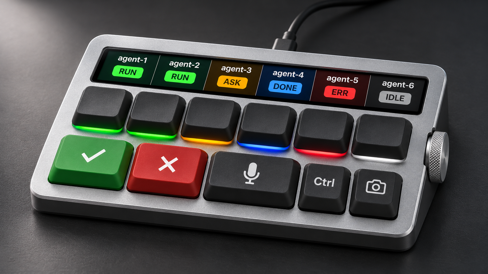

# AgentDeck（暂名）PRD（简版，一页）

版本 v0.2 · 2026-11-17 · 依据 `research/strategy-core.md` 第"二点六"节（审稿后决策 v2，D1–D9），与它冲突时以它为准。产品名暂用 AgentDeck（暂名）；D5 原候选"点将台"及 Baton / HelmPad / MuxKey 经公开初筛发现 Baton 等撞名严重，新增低冲突候选"驭阵 / ReinPad"、"帅台 / CueDial"等（见 `research/raw-gemini-naming.md`），正式商标检索均【待核实】，路演前由创始人定（D5）。

> 注：上图是按 D1 重画的 v2 概念渲染图（长条屏 + 6 个矮轴会话键，见第 7 节），不是实物样机；量产 BOM 按全注塑上下壳计（渲染图银色外观仅为示意，外壳最终材质待 ID 定）。

## 1. 问题（v2 修订）

一个开发者同时开着 3～10 个 AI 编码 agent（本地的 Claude Code、Codex、Cursor、Gemini/Antigravity、Trae、Qwen Code、Kimi、CodeBuddy，以及云端的 Cursor Cloud Agent、Codex 云任务）。瓶颈已经不是模型速度，而是**人发现不了谁在等他**：只能一个个切窗口看[1]；系统通知多了会被忽略[2]；每次批准都要把手伸回键盘，久了就不读命令直接点同意[3]。官方的 auto mode 正在把日常弹窗交给分类器（人工审查只拦下 13.6% 的危险操作，分类器拦下 89%）[14]，但**不可逆的操作**（推送主干、改生产、写数据库、改密钥、合并 PR）仍然需要人确认，而且最好是一个不会批错窗口的物理动作。

现有硬件都只照顾一部分人：Codex Micro 只管 Codex（$230）[4]；罗技 MX Keypad $99.99，原生支持 Copilot、Claude Code、Codex，但没有麦克风，也不做跨会话的审批[12]；优篮子 Vibe Key（AU05）¥269–299（部分渠道至 ¥319），6 键 + 旋钮 + 麦克风，通过 Ulanzi Studio 通用映射支持多家 agent，但**没有屏幕**，看不到谁在等、等的是什么命令[10][13]。

软件也在补这块（2026-11-18 新增）：Codex 桌面版 2026-05 上线了"宠物"浮层，会用气泡提示运行中、等你批准、可以验收，并发系统通知[16]；Claude 桌面版左侧会话栏也会标出哪个会话在等你。所以"告诉你谁在等"本身不够当卖点，设备要赢在三点：**同时看全所有家的 agent**、**不切窗口就能批**、**高危操作必须物理确认**。

【待补】大厂产品迭代慢，更该看开源社区和个人玩家做的东西（Reddit、X、小红书上的 DIY 宏键盘、状态灯、Stream Deck 插件），调研后补进竞品表。

## 2. 目标用户（v2 修订）

- **主力**：每天并行跑 3 个以上 agent 的专业开发者（独立开发者、创业团队工程师、大厂资深工程师），Windows / macOS / Linux 都有。（2026-11-18 创始人确认）
- **平台顺序**：先只做 Windows；macOS 等 Windows 版自用跑顺后，借一台真 Mac 集中调一轮再发布。
- **次要**：在意 agent 高危操作和审计的技术负责人、安全负责人（Team 版买家）。
- 约三分之一的 agent 使用者已在用多 agent 配置（Stack Overflow 2026-04 pulse，n=1,100）[5]。

## 3. 核心场景（v2 修订）

定位：**跨所有 agent 的 Codex Micro + 高危操作的物理二次确认**（D3）。

1. **谁在等我 → 一键过去**：长条状态屏按 6 等分显示每个会话的状态，下方对应的会话键亮 RGB 灯；有人等时变琥珀色，按一下就把对应终端/IDE 窗口切到前台。云端 agent（Cursor Cloud Agent、Codex 云任务、GitHub PR/CI 阻塞）也能占一个槽位，按下打开浏览器里的对应页面（P1）。
2. **高危操作的物理二次确认**：日常低风险命令（L0/L1）默认交给 agent 自己的 auto mode / 白名单，设备不抢活；设备重点拦不可逆操作（`git push`、生产环境 ssh/kubectl、数据库写入、改密钥、合并 PR）。这些命令即使 auto mode 打算放行，也要在设备上按两次 ✓ 才继续（L2）；`curl … | sh` 这类直接禁止设备放行（L3）。✓ / ✗ 直接回答 agent 的钩子[6][7]，不往窗口里打字，不会批错窗口；设备离线自动退回终端原生提示。接管范围可以在设置里改（比如 L1 也交给设备）。
3. **不打字就能指挥**：按住说话键，文字发进按下时选中的那个会话；Ctrl+会话键发送"继续 / 跑测试 / 提交"等模板；截图键把屏幕发给当前 agent。

## 3.5 第一版：自用闭环（2026-11-18 新增）

先做一条能每天拿来开发的完整链路，不追求功能多：

1. 在 Claude Code 或 Codex 里正常干活，agent 要批准时，键盘对应的键亮琥珀灯（灯效能否由电脑控制正在查），浮窗显示命令；
2. 按 ✓ 批准 / ✗ 拒绝，agent 继续跑；高危命令要按两次；
3. 任务结束，灯变回常态。

做到这一步就开始用它开发，边用边记问题。旧的 v0 状态屏钩子和 daemon 退役，避免抢串口。

## 4. MVP 功能清单（v2 修订）

| 优先级 | 功能 | 说明 | 现状（2026-11-17） |
|---|---|---|---|
| P0 | 本地中枢（hub） | 只监听 127.0.0.1 + token；会话表、稳定槽位 1–6、待批队列 | **已实现**（`pc/hub.py`，离线测试：中枢 264 项单元测试（`test_hub*.py`，含演示模式与虚拟 v2 设备窗口）+ 回放自检 12/12，全部通过） |
| P0 | Claude Code / Codex 审批直答 | `PermissionRequest` 应答；超时退回原生提示 | **已实现**，用真实 relay/hub 进程验证过；还没在真实 agent 会话里跑过 |
| P0 | 高危闸门 | 用 `PreToolUse` 钩子拦不可逆操作，设备确认后才放行；超时 deny | hub v1.4 已实现（两次 ✓ 返回 `{}`、✗ / 超时 deny、30 s 去重、`install --gate`），真实进程 + 真实系统热键验证；真实 auto mode 会话待测【待实测】 |
| P0 | 会话键：状态显示 + 一键聚焦窗口 | Windows / macOS 首发，Linux X11 同步，Wayland 部分支持 | Windows 已有；macOS 待做 |
| P0 | ✓ / ✗ / 打断 | L1 单击、L2 二次确认、L3 禁止；审计日志 | L2 二次确认、L3 极危锁死、哈希链审计日志已实现并用真实进程验证（v1.1）；设备随机数校验未做 |
| P0 | 安装器 + 首次引导 | 只写用户级钩子，先备份、可卸载；**引导用户在 Codex 里输入 `/hooks` 信任 AgentDeck 钩子**，10 分钟内没收到 Codex 事件就再提醒；检查 `claude` 命令行是否已登录 | 安装器已有；引导和检测待做 |
| P1 | 云端 agent 槽位 | GitHub PR/CI（本地轮询）、Cursor Cloud Agent、Codex 云任务；按下打开浏览器 | 待做【待实测】 |
| P1 | Cursor / Gemini-Antigravity / Qwen Code / Kimi / CodeBuddy / Trae 适配 | 按各家钩子能力分"应答 / 拦截 / 只读状态"三档。CodeBuddy（27 个事件）和 Qwen Code（23 个）都有 `PermissionRequest`，能不能代答要实测；Kimi 的 `PermissionRequest` 不能阻断；Trae 的事件表还没核实[11] | 待实测 |
| P1 | 按住说话 | 先用系统听写，再上本地 sherpa-onnx；懂代码的语音纠错归个人 Pro | 最小版（Win+H）已有；v1.2 加了按住期间焦点守护，真实听写未验证 |
| P1 | 模板指令、滚轮切会话 | Ctrl+会话键 = 模板；滚轮切换，停留后聚焦 | 部分 |
| P1 | 伴随浮窗 | 全量命令预览、设置、审计查看 | 置顶 6 槽小浮窗已实现并真机验证（v1.3：槽位状态、待批命令、风险档、✓ / ✗）；全量预览、设置、审计查看待做 |
| P1 | 驱动 Stream Deck / 优篮子 D200 / 普通宏键盘 | 免费软件拉新（D2） | 普通宏键盘已有；v1.3 F13–F24 全局热键已实现（Stream Deck / D200 可映射成热键用）；往它们按键屏推状态的原生插件待做 |
| P2 | 截图键 | 没有找到用户原声证据[8]，先做最小版验证 | 最小版已有 |
| P2 | 个人 Pro / Team 订阅功能 | 见第 8 节 | 待做 |
| P2 | BLE 无线 | v1 只做 USB-C 有线 | — |

## 5. 成功指标（v2 修订，对应 D7 验证清单）

- 路演前 6–8 周：Windows 和 macOS 上用真实 Claude Code、Codex 会话跑通钩子直答；招 30–50 名重度多开用户，用他们手上现有的键盘 / Stream Deck 试用，测 **D14 留存**和**每人每日按键次数**；落地页订金（海外 $1 / 国内 ¥9.9）≥ 300 人、获客成本 ≤ ¥60；2027-07 开模前累计订金 ≥ 1,500 人（见 08 第五节）。
- 首次安装到第一次用设备批准 ≤ 5 分钟；安装成功率 ≥ 90%（含 Codex 钩子信任这一步）。
- "agent 进入等待 → 用户响应"的中位时长比安装前下降 50%（hub 本地统计，用户自愿上传）。
- 按键到动作 p95 < 100 ms；错批（批到非目标会话）= 0；L2 高危操作 100% 经过二次确认。
- 众筹前积累 ≥ 2,000 名周活软件用户（对应 D6 第二期交割条件）。

## 6. 不做（本期）（v2 修订）

- 不做"一直允许"按钮，不开放远程批准（手机看板只读）。
- 不做 agent 编排、看板、云端托管 agent（Conductor、Vibe Kanban 一类）；云端 agent 只接状态和跳转。
- 不做 RSI / 无障碍主打宣传（证据弱[8]）；不做设备本地 ASR。
- 不替代 agent 自身的沙箱、权限规则和 auto mode，设备只做"高危操作的人确认"这一层[9]。
- 18 个月内不做第二款硬件（D2）。

## 7. 硬件与价格（v2 新增，D1、D2）

> 【形态待定，2026-11-18】创始人的原始设想是 **4×4 键盘**，下面的"长条屏 + 6 会话键 + 3 大键"是 v2 审稿后改出来的。两种方案的对比见讨论记录，定稿前本节不当最终结论。

- **结构**：上方一条 3.2–3.5 寸长条 IPS 状态屏，按 6 等分对齐下方 6 个矮轴机械会话键（每键 RGB 状态灯）；下方 ✓ / ✗ / 按住说话三个大号机械键；Ctrl、截图键；右侧金属滚轮；板载麦克风。主控 ESP32-S3；v1 USB-C 有线，BLE 以后再做。
- **唯一一款**：国内 ¥499（众筹早鸟 ¥399），海外 $99（早鸟 $79）。不做 Lite，Pro 往后放。
- 否决过的方案：6 块独立 0.85 寸小屏（BOM 高、USB 带宽吃紧、屏和机械轴对不齐）；整块屏 + 透明键帽（只能用硅胶按键，没法用机械轴）。

## 8. 收入（v2 新增，D4）

| 项 | 价格 | 内容 |
|---|---|---|
| 软件 | 免费 | 中枢、适配器、兼容 Stream Deck / 优篮子 D200 / 普通宏键盘（现支持 F13–F24 热键 + 置顶浮窗；按键屏原生插件待开发） |
| 硬件 | ¥499 / $99 | 第 7 节 |
| 个人 Pro | ¥19/月，$3.99/月 | 懂代码的语音纠错（能认出函数名、文件名）、手机端只读状态看板、云端 agent 桥接 |
| Team | ¥39–59/人/月 | 企业 SSO（飞书 / 企微 / 钉钉 / Okta）、合规仪表盘、私有化部署、MCP 工具白名单 |

不向优篮子收 OEM 授权费（同名开源项目已免费上架优篮子插件商店[15]）。

## 来源

[1] anthropics/claude-code issue #36885：https://github.com/anthropics/claude-code/issues/36885
[2] issue #13024 中 JackRostron 评论：https://github.com/anthropics/claude-code/issues/13024
[3] Atomic Object, Permission fatigue：https://spin.atomicobject.com/permission-fatigue-claude-code ；HN：https://news.ycombinator.com/item?id=50408126
[4] Fortune 2026-07-27：https://fortune.com/2026/07/27/openai-first-hardware-device-micro-codex-keyboard-sold-out-12-hours-reselling-on-ebay-premium/
[5] Stack Overflow Blog, Agents on a leash：https://stackoverflow.blog/2026/05/27/agents-on-a-leash-agentic-ai-remains-mostly-monitored-at-work
[6] Claude Code hooks：https://code.claude.com/docs/en/hooks
[7] Codex hooks（新增或改动的钩子要用户信任后才运行）：https://learn.chatgpt.com/docs/hooks
[8] 内部调研 `research/raw-voices.md` 第 1.4、4 节
[9] Claude Code security：https://code.claude.com/docs/en/security
[10] InfoQ 实测 Vibe Key：https://www.infoq.cn/article/joXcPA6XF1QWgik9OALj ；拆解：https://www.52audio.com/archives/1794308264984.html
[11] CodeBuddy hooks：https://www.codebuddy.cn/docs/cli/hooks ；Qwen Code hooks：https://github.com/QwenLM/qwen-code/blob/main/docs/users/features/hooks.md ；Kimi Code hooks：https://www.kimi.com/code/docs/kimi-code-cli/customization/hooks.html ；Trae hooks：https://docs.trae.ai/ide/automate-actions-with-hooks
[12] 罗技 MX Keypad（$99.99，2026-09）：https://9to5mac.com/2026/09/08/logitech-mx-keypad-99-ai-coding/ ；https://www.logitech.com/en-us/products/keyboards/mx-keypad.html
[13] 优篮子 AU05 Vibe Key：https://www.ulanzi.com/products/au05-vibe-key-ai-voice-input-keypad-i018 ；https://docs.ulanzistudio.com/vibekey/au05
[14] Anthropic, Claude Code auto mode：https://www.anthropic.com/research/claude-code-auto-mode
[15] puritysb/AgentDeck：https://github.com/puritysb/AgentDeck
[16] Codex 宠物（二手报道，未见官方文档）：https://dataconomy.com/2026/05/04/openai-adds-codex-pets-animated-overlay-to-coding-tool/ ；https://www.hongkiat.com/blog/codex-pets-custom-hatch-guide/ ；用户反馈"宠物不如任务看板"：https://community.openai.com/t/feature-request-replace-codex-pet-with-a-codex-task-board/1397992
