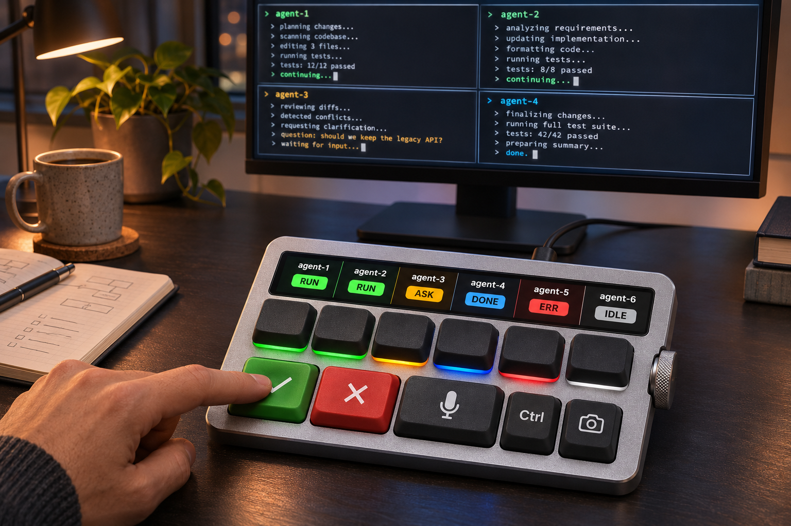
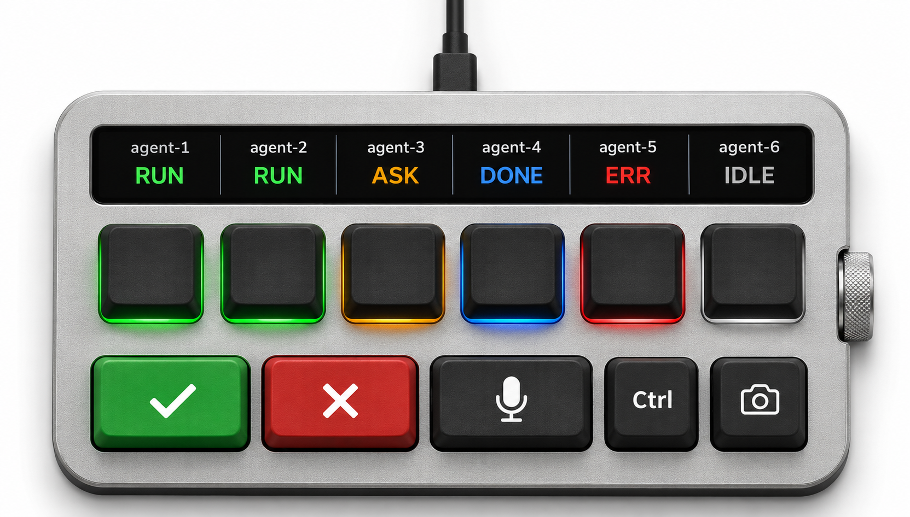
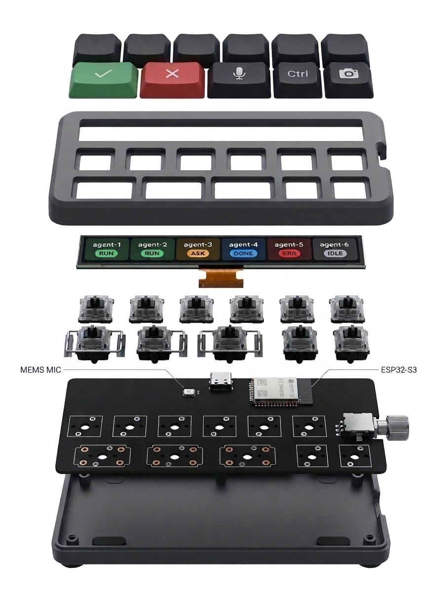

# AgentDeck（暂名）PRD（详细版）

版本 v0.2 · 2026-11-17 · 产品负责人起草，供融资材料和工程立项共用。
定位、价格、风险以 `research/strategy-core.md` 为准，其中第"二点六"节（审稿后决策 v2，D1–D9）覆盖一切冲突内容；技术细节见 `07-技术方案.md`。
标【估算】的数字没有外部来源，只用来判断量级；标【待实测】的能力没在真机上验证过，不能对外承诺。
v2 改动的章节标了"（v2 修订）"。产品名仍写 AgentDeck（暂名），D5 原候选"点将台 / Baton / HelmPad / MuxKey"经初筛发现 Baton 撞名严重，新增低冲突候选"驭阵 / ReinPad"、"帅台 / CueDial"等（正式商标均【待核实】，由创始人定）。



> 注：上图是按 D1 重画的 v2 概念渲染图（长条屏方案，§3.1），不是实物样机；外壳材质待定（见 §8）。

---

## 0. 一句话与设计原则（v2 修订）

**AgentDeck 是跨所有 agent 的 Codex Micro，外加高危操作的物理二次确认（Hardware 2FA for Agents）。** 按键是主角，它真正去控制电脑：切窗口、确认高危操作、打断、派指令。屏幕和灯只是给按键提供上下文。

v2 的重心调整（D3）：Claude auto mode 已默认开启，官方分类器拦下 89% 的危险操作，而人工审查只拦下 13.6%[17]。所以设备**不和 auto mode 抢日常命令**：L0/L1 默认交给 agent 自己的 auto mode / 白名单；设备只拦不可逆、跨边界的操作（`git push`、生产环境 ssh/kubectl、数据库写入、改密钥、合并 PR），像"发射钥匙"一样要求人用手确认。会话槽位也从"本地终端"扩展到云端 agent（P1，§3.11）。

五条设计原则，后面所有功能都按这五条取舍：

1. **控制优先于通知。** 光显示"谁在等"不够，按一下就要到那里，或者直接把事办了。通知做多了会被忽略，用户原话是"After a day of that, you start ignoring them"[13]。
2. **能走官方接口就不模拟键盘。** 批准和拒绝走 agent 的钩子；只有官方接口做不到的事（发文字、打断），才退回到聚焦窗口加输入。
3. **出错时一律退回原生流程（fail-closed）。** 设备离线、中枢崩溃、请求超时，都退回 agent 自己的终端提示，绝不默认放行。
4. **审批要让人看清再按，而且只在值得的时候打扰人。** 用户手动盲批了 97% 的权限提示[17]，"不读就点"是公认的风险[15][16]；一键 yolo 会招来批评[29]。设备必须显示真实命令，高风险要多一步；低风险交给 auto mode，避免把人再训练成"不读就按"。
5. **本地优先。** 默认不联网，命令文本不出本机，统计数据要用户主动开启。（v2）云端功能（云端 agent 轮询、个人 Pro 的桥接和手机看板）都要用户主动开启，默认只传状态元数据。

---

## 1. 用户画像（v2 修订）

| 画像 | 描述 | 当前做法与痛点 | 对 AgentDeck 的期待 | 对应产品 |
|---|---|---|---|---|
| **P1 阿哲：独立开发者 / 小团队全栈** | 29 岁，Windows + WSL，同时开 Claude Code ×3、Codex ×1、Cursor ×1；在国内用"Claude Code 客户端 + GLM/Kimi 端点" | 一个个 Alt-Tab 找等他的那个窗口；一天批准几十次；经常发现某个会话已经等了十分钟 | 一眼看到谁在等，按一下过去；✓/✗ 不用切窗口 | 硬件 ¥499 + 个人 Pro（语音纠错） |
| **P2 林工：大厂资深工程师** | 34 岁，工作机 macOS，公司要求用 CodeBuddy / Trae，下班用 Claude Code | 公司对 agent 跑危险命令很敏感，要求留审计记录 | 国产 agent 也能接；高危操作必须物理二次确认；可导出审计 | 硬件 + Team 版 |
| **P3 Maya：海外 staff engineer / tech lead** | macOS + tmux，本地 5 个 agent，外加网页端 / 云端 5～10 个（参照 Claude Code 作者本人的工作流[30]） | 会话太多，看不过来；云端 agent 跑完没人看；不想再买只支持一家的 $230 设备 | 中立、跨平台、支持 tmux 精确定位、云端 agent 也能占槽位、手感好 | 硬件 $99 + 个人 Pro（云端桥接、手机看板） |
| **P4 安全负责人 / 团队管理者** | 管 20～200 名工程师 | 63% 的 agent 使用者很少或从不让 agent 完全自动运行[18]，但缺统一的高危操作策略、身份绑定和审计 | 统一风险规则、SSO、MCP 工具白名单、合规仪表盘、私有化部署 | Team 版 |

不作为主画像：RSI / 无障碍用户（证据弱，只把语音当附加能力）、只用单个 agent 的人（单会话时它就是个贵的宏键盘）。

---

## 2. 用户旅程（v2 修订：去掉状态环，"键屏"改为长条屏上对应的那一格 + 会话键 RGB 灯；新增 2.3 的高危闸门和 2.6 云端 agent）

### 2.1 早上开工

1. 08:55 开机，hub 随系统启动（托盘图标），设备上电后长条屏 6 格全灰，6 个会话键的灯熄灭。
2. 阿哲在 3 个仓库各启动一个 Claude Code、一个 Codex。每个会话的第一个钩子事件（`SessionStart`）一到达，就按出现顺序占住槽位 1–4，屏上对应的格子显示 agent 图标 + 项目名（如 `api`、`web`、`infra`），状态 `READY`。如果 10 分钟内看到了 Codex 进程却没收到任何 Codex 钩子事件，托盘提示"Codex 钩子可能还没信任，请在 Codex 里输入 /hooks"（§6.1）。
3. 他在 K1 的会话里输入任务，K1 变蓝 `THINK`；开始跑工具时变青 `TOOL`，并显示工具名缩写（`Bash`、`Edit`）。
4. 昨天没关的会话，如果它的进程已经不在、12 小时内也没有事件，就自动释放槽位，不会占着 K5、K6。
5. **验收**：开工 2 分钟内，用户不需要任何配置，就能在状态屏上看到所有活跃会话。

### 2.2 多 agent 冲刺（5 个 agent 并行）

1. 5 个会话：K1 Claude（后端）、K2 Claude（前端）、K3 Codex（测试）、K4 Cursor（文档）、K5 Qwen Code（脚本）。
2. 10:12 K3 发来 `PermissionRequest`（这是 Codex 自己的审批模式仍然要问的一条）。K3 的灯变琥珀色并闪烁，屏上第 3 格显示 `ASK`；✓ 键背光亮起；如果当前没有别的待批请求在显示，长条屏切到"审批视图"：整条屏显示 K3 的命令全文（最多 3 行）和风险等级，6 格缩成顶部一行小状态条。
3. 他正在 K1 的窗口里读 diff，不想切过去：看一眼屏上的 `npm test -- --watch=false`（风险 L1），按 ✓。50 ms 内 Codex 收到 allow，K3 回到 `TOOL`。
4. 10:15 K2 和 K5 几乎同时请求批准。按到达顺序排队：先显示 K2，长条屏第 5 格右上角出现角标 `1`。批完 K2，审批区自动切到 K5。**✓ 永远只作用于审批区正在显示的那一条**，绝不会批到别的会话。
5. 10:20 K4（Cursor）卡在一个需要回答问题的对话框里。这种情况没有钩子可以代答，K4 显示 `INPUT`；按 K4，Cursor 窗口切到前台，光标落在输入框。
6. 10:31 K1 完成，显示绿色 `DONE` 和耗时，3 秒后转成"已完成未查看"的小绿点；按 K1 查看后小绿点消失。
7. **验收**：5 个会话并行 1 小时，用户不需要 Alt-Tab 找窗口；批错对象的次数为 0。

### 2.3 危险命令审批（高危闸门）

1. K2 是开着 auto mode 的 Claude Code，它准备执行 `git push --force origin main`。auto mode 本来可能直接放行，但 AgentDeck 的高危闸门（`PreToolUse` 钩子，§5.4）先拦下来，分类器判为 **L2 高风险**（命中 `git push --force`）。
2. 长条屏变红底审批视图，显示 `⚠ git push --force origin main`；K2 的灯红色快闪；伴随浮窗（如果开着）弹出完整命令、`cwd`、命中的规则名。
3. 用户按一次 ✓：设备**不放行**，屏上提示"再按一次确认"（1.5 秒内有效）。在 1.5 秒内再按一次才放行；超时就要从头来。也可以在设置里改成"长按 ✓ 0.6 秒"。
4. 如果是 `curl … | sh` 或写 `~/.ssh/`，判为 **L3 禁止设备批准**：✓ 无效，屏上显示"请在终端确认"，只能按 ✗ 拒绝，或者按会话键跳过去在终端里自己处理。
5. 每次决策都写进本地审计日志：时间、agent、会话、cwd、原始命令（敏感串打码）、风险等级、命中规则、决策、输入来源、耗时。
6. **验收**：L2 不能单击放行；L3 在设备上无法放行；审计日志里每条决策都对得上请求 id。

### 2.4 语音派活

1. 用户转动滚轮把选中框移到 K5（Qwen Code，`READY`），停留 0.4 秒后，对应终端切到前台。
2. 按住麦克风键：屏上第 5 格显示 `● REC`，K5 的灯变白色呼吸。**目标会话在按下的那一刻锁定**，录音期间即使别的会话来了请求，文字也只发给 K5。
3. 说"把 scripts 目录下的 shell 脚本都加上 set -euo pipefail，然后跑 shellcheck"，松开。
4. 识别结果在浮窗上预览 1.5 秒（期间按 ✗ 取消），然后粘贴进 K5 的输入框，**默认不按回车**；Ctrl+麦克风键 = 粘贴后自动回车。
5. 第一阶段用系统听写（Windows Win+H、macOS 听写），Claude Code 会话可以选择改用它内置的 `/voice`（按住空格说话）[19]；第二阶段用本地 sherpa-onnx。
6. **验收**：从松开到文字出现在目标会话 ≤ 1.5 秒（系统听写）；文字不会发错会话。

### 2.5 离开和回来

1. 12:00 用户去吃饭，K1–K5 都在跑。
2. 期间 K3 请求批准、K4 出错。屏和灯保持琥珀色和红色。订了个人 Pro 的用户可以在手机看板上看到这两条（只读，不能批准）。**设备不会代用户批准，也不会远程推送批准**（远程批准不在本期范围）。
3. Claude Code 和 Codex 的待批请求在中枢里最多挂 110 秒，然后中枢返回空结果，agent 回到终端里的原生提示继续等。设备上这条请求标为"已转终端"，屏上显示琥珀色 `ASK·T`（T 表示要去终端处理）。高危闸门拦下的请求超时则返回 deny（§5.4），agent 会收到"AgentDeck 超时未确认"的原因。
4. 12:40 回来，屏上一眼看到：K3 `ASK·T`、K4 `ERR`、其他 `DONE`。滚轮按下 = "跳到最紧急的那个"，顺序是：待批 > 出错 > 等输入 > 刚完成。
5. 回来后的第一次按键会让浮窗显示"离开期间摘要"：每个会话的最后状态，加上 Claude Code `Stop` 事件里的 `last_assistant_message` 前 80 个字[1]。
6. **验收**：离开期间不会有任何放行；回来 10 秒内能定位到所有需要处理的会话。

### 2.6 云端 agent（P1，v2 新增）

1. Maya 早上在网页上给 Cursor Cloud Agent 派了一个重构任务，又给 Codex 云任务派了一个修 bug 的任务。她在浮窗里把这两个任务"钉"到 K5、K6（或者让 AgentDeck 自动把新出现的云端任务放进空槽）。
2. K5、K6 的格子显示云图标 + 任务名，状态 `CLOUD·RUN`（青色）。云端状态来自轮询或 webhook（§3.11），延迟 ≤ 60 s（免费版轮询）或 ≤ 5 s（个人 Pro 的云端桥接）【估算】。
3. 11:05 Cursor Cloud Agent 跑完，开了一个 PR 等 review：K5 变琥珀色 `REVIEW`。Maya 按 K5，浏览器打开这个 PR 的 diff 页面。
4. 11:20 她自己的 PR 在 GitHub 上 CI 挂了：自动出现在空槽 K4，红色 `CI ✗`。按 K4 打开失败的 CI 日志页面。
5. 云端 agent 不在本机跑，设备**不能**替它批准或拒绝；✓ / ✗ 对云端槽位无效（按下等于"打开页面"）。
6. **验收**：云端任务状态变化后 60 s 内（免费版）反映到屏上；按下 100% 打开正确的页面。

---

## 3. 功能规格（v2 修订）



### 3.1 物理布局（v2 修订，D1）

```
┌───────────── 3.2–3.5" 长条 IPS 状态屏，6 等分 ─────────────┐
│  区1  │  区2  │  区3  │  区4  │  区5  │  区6  │
└──────────────────────────────────────────────┘
 [K1] [K2] [K3] [K4] [K5] [K6]          ← 6 个矮轴机械会话键，每键 RGB 状态灯
 [  ✓  ] [  ✗  ] [ 🎙 按住说话 ] [Ctrl] [📷]   (滚轮)  ← 三个大号机械键（均带 RGB 背光）+ 修饰键、截图；右侧金属滚轮（可按下）
```

- 按键排成两排，与 v2 概念渲染图一致；共 11 键（6 会话键 + 3 大键 + Ctrl + 截图），9 颗 RGB 灯（6 会话键 + 3 大键背光，与 08 BOM 一致）。具体尺寸和排布以 ID 定稿为准。

- 屏幕的每一格与下方会话键左右对齐，用户看格子、按下面的键。候选面板是市面常见的 3.49 寸 172×640 长条 IPS（每格约 106×172 像素，QSPI 接口，驱动 IC AXS15231B；工业裸屏样品价 $6.90–11.50/片，微雪同款开发板约 $30 可搭手板，量产阶梯报价待工厂确认，见 `research/raw-gemini-supply.md`）。
- 屏幕由主控 ESP32-S3 通过 SPI/QSPI 直接驱动，图标、字体存在设备里；电脑只发"状态 + 短文本"，不发整帧画面（技术方案 §10）。
- 会话键用矮轴（热插拔），✓ / ✗ / 说话用标准机械轴 + 大键帽（超过 2U 加卫星轴，具体尺寸等 ID 定）。全键机械轴是相对 Stream Deck / 优篮子 D200 一类"整屏 + 硅胶键"产品的手感差异。
- 板载 MEMS 麦克风（罗技 MX Keypad 没有麦克风[31]，这是差异点）。
- 连接：v1 只做 USB-C 有线；BLE 无线以后再做。

**否决的方案**（记录原因，防止回头）：

| 方案 | 为什么不用 |
|---|---|
| 6 块独立 0.85" 128×128 IPS 屏，每个会话键上一块（v0.1 方案） | ① 6 块屏在 1k 台时约 $36，占 BOM 最大头[27]；② 屏要嵌进键帽或放在轴旁边，机械轴中心不透光，结构和良率都没底（概念爆炸图里甚至画成了 6 块屏配 5 颗轴）；③ 主机通过全速 USB HID 推 6 块屏的画面，6 键全刷约 0.9 s，必须靠一堆图标库技巧补救 |
| 整块大屏 + 透明键帽（Stream Deck、优篮子 D200 的做法） | 只能配硅胶按键，屏幕上方不能有轴，没法做机械轴手感；而且和 D200 正面撞车 |
| 没有屏幕，只有 RGB 灯（Codex Micro、优篮子 Vibe Key 的做法） | 看不到要执行的命令，高危操作的"看清再按"就无从谈起 |

### 3.2 会话键 K1–K6（v2 修订：显示改在长条屏对应的格子里，键上只有 RGB 灯）

**槽位分配**：会话第一次出现时，按顺序占第一个空槽，之后槽位号固定不变，直到会话结束（`SessionEnd`、进程消失或超时）才释放。用户可以长按某个会话键把它"钉住"，钉住的会话结束后槽位保留 10 分钟给同一项目的新会话。超过 6 个会话时，第 7 个及以后进入"溢出列表"，只能用滚轮或浮窗访问；K6 右上角显示 `+N`。

**每一格的内容**（约 106×172 像素，由设备本地渲染，见技术方案 §10）：

| 区域 | 内容 |
|---|---|
| 左上 | agent 图标（Claude / Codex / Cursor / Gemini / 千问 / Kimi / CodeBuddy / Trae / 云端 / 通用机器人） |
| 右上 | 待处理角标（数字）或"钉住"图钉 |
| 中部 | 状态字 + 图标（见下表） |
| 下部 | 项目名，最多 8 个半角字符或 4 个汉字，超长往返滚动 |
| 底边 | 状态持续时间（`12s`、`5m`、`2h`），设备按开始时间自己计时 |

**审批视图**：有待批请求在显示时，整条屏变成一张审批卡：命令全文（最多 3 行，超长可用滚轮滚动）、风险等级底色、agent 和项目名；6 格缩成顶部一行小状态条。这是长条屏相对"每键一块小屏"的好处：长命令也能看全。

**会话键 RGB 灯**：颜色和下表"颜色"一列一致；琥珀闪 = 等你，红色快闪 = 高危确认中，白色呼吸 = 正在录音。屏幕被遮挡或用户没看屏时，靠灯也能知道谁在等。

**状态**（与原型 1602 屏固件一致，并扩展了等待、失联和云端的细分）：

| 状态 | 颜色 | 字 | 来源事件（以 Claude Code 为例[1]） |
|---|---|---|---|
| empty | 灰暗 | — | 无会话 |
| idle | 白 | READY | `SessionStart`、`Stop` 之后超过 5 分钟 |
| think | 蓝 | THINK | `UserPromptSubmit`、`PostToolUse` |
| tool | 青 | TOOL + 工具名 | `PreToolUse` |
| ask | 琥珀，闪 | ASK | `PermissionRequest`（可代答） |
| ask·T | 琥珀，常亮 | ASK·T | 代答超时，已转终端；或该 agent 只能显示、不能代答 |
| input | 琥珀，慢闪 | INPUT | `Notification`（`elicitation_dialog`），或可靠的 idle 提示 |
| done | 绿 | DONE | `Stop`（前 3 秒大对勾，之后变"未查看"小绿点） |
| error | 红 | ERR | 工具失败、`StopFailure` 一类事件、进程异常退出 |
| stale | 灰 + 虚线框 | ? | 30 分钟没有事件、进程仍在（可能是 hook 丢了） |
| cloud·run / review / ci✗ | 青 / 琥珀 / 红 | CLOUD·RUN / REVIEW / CI ✗ | 云端 agent 槽位（§3.11），来自轮询或 webhook |

`idle_prompt` 有误报，Claude 刚回答完就触发[14]，所以**不能单靠它判断 INPUT**，要和 `Stop` 时间、窗口焦点交叉判断（规则见技术方案 §4）。

**按键语义**：

| 操作 | 行为 |
|---|---|
| 单击 | 选中该会话，并把它的窗口 / 标签 / tmux pane 切到前台 |
| 双击 | 切到前台，同时在浮窗里展开这个会话的详情（最近事件、待批列表） |
| 长按 0.6 s | 钉住 / 取消钉住；在浮窗里可以改名、解绑窗口、"把当前前台窗口绑给这个会话" |
| Ctrl + 单击 | 发送模板指令 N（见 3.6），作用于**当前选中的会话**；按住 Ctrl 时屏上 6 格换成模板名 |

**边界情况**：
- 空槽按下：屏闪一下"空"，不做任何事。
- 找不到窗口：屏显示"找不到窗口"，浮窗提示"切到那个窗口后长按本键绑定"；记住这次绑定。
- 同一窗口里跑多个会话（Windows Terminal 多标签、tmux 多 pane）：优先用终端自己的定位接口（tmux / WezTerm / kitty / iTerm2），做不到时只切到窗口，屏上加注"同窗多会话"。
- 会话结束：屏上那一格变灰显示 `END` 10 秒，然后释放槽位（钉住的除外）。
- 管理员权限的终端：Windows 上普通权限的进程不能向它注入输入，而且会**静默失败**[24]。hub 检测到目标进程权限更高时，屏上提示"管理员窗口，仅可切换"，不再尝试发文字。

### 3.3 ✓ 批准键（v2 修订）

- 作用对象：审批视图当前显示的那一条请求（有请求 id 和 nonce）。没有在显示的请求时按 ✓，屏上提示"没有待批"，不做任何事。**不复用成"回车"或"继续"**，防止误触。
- 设备接到的请求有两个来源：① agent 自己的审批模式仍然要问的 `PermissionRequest`（auto mode 开着时这类请求会少很多）；② AgentDeck 高危闸门用 `PreToolUse` 拦下的不可逆操作（§5.4），**即使 auto mode 打算放行也会拦**。
- 风险分级与操作：

| 等级 | 例子 | 默认谁处理 | 设备操作 |
|---|---|---|---|
| L0 只读 | `ls`、`git status`、读文件 | agent 的 auto mode / 白名单 | 如果 agent 仍然来问：单击（AgentDeck 不替用户自动放行） |
| L1 普通 | `npm test`、编辑工作区里的文件、`git commit` | agent 的 auto mode / 白名单 | 如果 agent 仍然来问：单击 |
| L2 高危（不可逆 / 跨边界） | `git push`（默认只拦推到 main/master/release 和 `--force`）、`git reset --hard`、`rm -rf`、生产环境 `ssh` / `kubectl` / `terraform apply`、数据库写操作（`DROP` / `DELETE` / `UPDATE` / 迁移）、改密钥和 `.env`、`gh pr merge`、`sudo`、`chmod -R 777` | **AgentDeck 高危闸门**，auto mode 开着也拦 | 1.5 秒内按两次（或长按 0.6 s，可设置）；屏幕红底 |
| L3 禁止设备批准 | `curl/wget … \| sh`、`iex (iwr …)`、base64 解码后执行、写 `~/.ssh` / `.git/hooks` / agent 的设置文件、PowerShell `-EncodedCommand` | AgentDeck 高危闸门 | 设备上 ✓ 无效，只能 ✗ 或去终端 |

- **接管范围可配置**：默认"只拦 L2/L3"（推荐和 auto mode 一起用）；可以改成"L1 起都交给设备"（不开 auto mode 的人），或者"关闭闸门，只回答 agent 自己问的"。"生产环境"的判断靠用户填的主机名 / kube context / 数据库连接串列表。
- 规则是可编辑的列表（正则 + 工具名 + 路径），Team 版可以下发并锁定。
- 只提供"允许这一次"，**不提供"一直允许"**[20]。agent 返回的 `permission_suggestions` 一律忽略。
- 重复按：同一请求已经决定后，再按 ✓ 不会作用到下一条，要等审批区切换并亮 300 ms 之后才接受新的 ✓（防连击）。

### 3.4 ✗ 拒绝键

- 单击：拒绝审批区当前的请求，附带消息"Denied from AgentDeck"让 agent 知道原因。
- 长按 1 s：拒绝并打断。Claude Code 用 `interrupt: true`[1]；Codex 的 `interrupt` 是保留字段，不能返回[2]，所以改为拒绝后再向会话发 Esc。
- Ctrl + ✗：没有待批请求时，打断当前选中的会话（聚焦后发 Esc，有 tmux 时用 `send-keys`）。
- 没有待批、也没按 Ctrl：提示"没有待批"，不做任何事。

### 3.5 滚轮

| 操作 | 行为 |
|---|---|
| 转动 | 在有会话的槽位（含溢出列表）之间移动选中框；停留 0.4 s 后才切窗口（避免一路滚一路闪窗口） |
| 按下 | 跳到最紧急的会话（待批 > 出错 > 等输入 > 刚完成） |
| 审批区有长命令时转动 | 滚动命令文本（优先级高于切会话，浮窗同步） |
| Ctrl + 转动 | 调模式：Claude Code 循环权限模式（向会话发 Shift+Tab）；Codex / 其他 agent 调推理强度（发对应的斜杠命令）【待实测，P2】 |

### 3.6 Ctrl / 模板指令

- Ctrl 单独单击：显示或隐藏浮窗。
- 按住 Ctrl：屏上 6 格变成 6 条模板的名字；Ctrl+Kn 把模板 n 粘贴到当前选中的会话并回车。
- 默认模板（中英各一套）：继续 / 跑测试 / 总结进度 / 提交 / 解释上一步 / 停下来先别改。
- 模板支持变量：`{project}`、`{branch}`、`{clipboard}`。
- 如果选中的会话处于 ASK 状态，模板会被拦下并提示"先处理审批"，防止文字被当成审批回答。

### 3.7 截图键（P2，需验证）

- 单击：截取当前活动窗口，存为 PNG，把文件路径粘贴进选中的会话（不回车）。Claude Code 可以直接读图片路径。
- 长按：浮窗进入框选模式。Ctrl + 单击：截全屏。
- 图片存在 `~/.agentdeck/shots/`，默认保留 7 天。
- 用户调研里没有找到"截图发给 agent"的原声证据，这个功能先做最小版，用使用率决定量产版是否保留"截图"这个默认功能（实体键保留，不用截图就改成可自定义键）。

### 3.8 按住说话（P1）

- 目标会话在按下时锁定；录音期间屏上对应的格子显示 `● REC`。
- 松开后预览 1.5 s（按 ✗ 取消），然后粘贴。Ctrl + 说话 = 粘贴后回车。
- 引擎：系统听写 → 本地 sherpa-onnx（中英）→ 用户自己配置的云端 ASR（需主动开启）。
- 录音最长 60 s；目标会话在录音期间结束时，文字转存到剪贴板，并提示"目标已结束"。
- 板载 MEMS 麦克风以 USB 音频设备出现（v2 已定板载，罗技 MX Keypad 和 Codex Micro 都没有[31]）。没装驱动或用户关掉时，退回电脑麦克风。
- 个人 Pro 的"懂代码的语音纠错"见 §7.1。

### 3.9 状态环 Ring（v2 修订：不在 v1，列为未来配件）

（v0.1 的状态环配件图 `concept/ring.png` 已作废，不再放在正式 PRD 里。）

- v1 只有一款有线设备（D1、D2），不带状态环，也不做 BLE。下面的设计留作以后的配件选项，前提是 v1 卖得动。
- 设想：BLE 连接，吸附在显示器边上，只显示**汇总**状态；熄灭 = 没有会话；蓝色呼吸 = 有 agent 在干活；琥珀色 = 有人等你；红色 = 有错误。
- **防止通知疲劳的升级阶梯**（v1 就要做，不依赖 Ring）：0 s 屏和会话键灯变色 → 2 min（可选）系统通知 → 默认永远不出声。可以设置勿扰时段，也可以单独静音某个会话。

### 3.10 伴随应用（托盘 + 浮窗）

- 托盘：hub 运行状态、设备连接、已接入的 agent、暂停 AgentDeck（暂停时所有钩子直接返回空，走原生流程）。
- 浮窗（默认关闭，Ctrl 单击打开）：置顶小面板，列出所有会话；审批卡片显示完整命令、cwd、工具名、风险等级、命中规则、倒计时；离开期间摘要；语音预览。
- 浮窗上的按钮和设备按键走同一条动作通道（`POST /action`），但**浮窗按钮不能放行 L2/L3**，只能拒绝或跳转。这样就不存在"不带设备也能一键放行高风险"的旁路。
- 设置页（见 §6）、审计日志查看器（按会话、风险、决策筛选，可导出 JSONL / CSV）。

### 3.11 云端 agent 槽位（P1，v2 新增，D3）

重度用户正在把一部分任务交给云端 agent（Cursor 年化收入破 $40 亿，增量里有 Cloud Agents[32]）。这些 agent 跑在云端容器里，本机没有进程、也不会调用本地钩子，所以要换一种接法。

| 来源 | 怎么接 | 槽位状态 | 按下会话键 | 现状 |
|---|---|---|---|---|
| GitHub PR / CI（含 Copilot coding agent 开的 PR） | 免费版：hub 用用户本机已登录的 `gh` 或用户填的只读 token，每 60 s 轮询"等我 review 的 PR""我的 PR 的检查结果"；个人 Pro：我们的云端桥接接收 GitHub webhook，经 hub 主动建立的出站连接实时推送 | 有人请我 review → `REVIEW`；CI 失败 → `CI ✗`；可以合并 → `READY` | 浏览器打开 PR 或失败的检查页面 | 待做 |
| Cursor Cloud Agent | 通过 Cursor 提供的 agent 接口查询任务状态（轮询；如果官方提供 webhook 就走云端桥接）[32] | 运行中 → `CLOUD·RUN`；完成待 review → `REVIEW`；失败 → `ERR` | 浏览器打开该任务页面或它开的 PR | 待做【待实测：接口和鉴权方式】 |
| Codex 云任务 | 通过 Codex 官方的云任务列表（CLI 子命令或接口，以官方文档为准）轮询 | 同上 | 浏览器打开该任务页面 | 待做【待实测】 |

- **槽位规则**：云端任务默认不自动占槽，只有"等我"（REVIEW / CI ✗）的才自动进空槽；用户可以手动钉住。
- **不做**：不替云端 agent 批准或拒绝（✓ / ✗ 在云端槽位上无效，按下 = 打开页面）；不在设备上合并 PR（以后可评估"按两次 ✓ 合并"，要先过安全评审）。
- **隐私**：免费版的轮询全在本机，凭据存系统钥匙串；个人 Pro 的云端桥接只转发状态元数据（仓库名、PR 号、状态、链接），不转发代码和日志内容。

---

## 4. Agent 支持矩阵（v2 修订）

把各家的钩子能力分成三档，决定 ✓/✗ 在这家 agent 上能做到哪一步：

- **A 代答**：agent 弹出权限提示时会调用钩子，钩子返回 allow/deny 就等于回答了提示；超时就回到原生提示。体验最好。
- **B 拦截等待**：钩子在工具执行前阻塞，等设备的决定后返回 allow/deny。这本质上是"钩子自己当审批人"，和 agent 自带的弹窗是两套机制，可能出现"两次确认"，也要单独处理超时。默认关闭，用户主动开启。
- **C 只读状态**：只能显示状态和切窗口，✓/✗ 在这家 agent 上不可用（按下后跳到窗口）。

| Agent | 形态 | 状态来源 | 审批能力 | 关键细节 | 支持计划 | 来源 |
|---|---|---|---|---|---|---|
| Claude Code | CLI / VS Code | `SessionStart`、`UserPromptSubmit`、`PreToolUse`、`PostToolUse`、`Notification`、`Stop`、`SessionEnd` | **A**：`PermissionRequest` 返回 `decision.behavior`；高危闸门用 `PreToolUse` | allow 不会覆盖 deny 规则；超时或失败时输出被丢弃，回到原生弹窗；支持 http 型钩子。（v2）真会话测试要求本机 `claude` 命令行已登录（桌面版凭据不共用） | P0；直答已在 hub 实现，真会话【待实测】 | [1] |
| Codex CLI | CLI / 桌面 | `PreToolUse`、`Stop`、`notify`（只有 `agent-turn-complete`） | **A**：`PermissionRequest`；高危闸门用 `PreToolUse` | 不能返回 `updatedInput` / `updatedPermissions` / `interrupt`（"fail closed today"）；多个钩子时任何一个 deny 就算 deny。（v2）**新增或改动的钩子要用户在 Codex 里用 `/hooks` 信任后才运行**，没信任时钩子被静默跳过；`codex exec` 非交互模式不触发 `PermissionRequest` | P0；直答已用真实 relay/hub 进程验证，真会话【待实测】 | [2][3] |
| Cursor | IDE | `preToolUse`、`beforeShellExecution`、`beforeMCPExecution` 等 | **B**：返回 `permission: allow/deny/ask`；`ask` 回到 Cursor 自己的弹窗 | 非 0 退出码默认放行，必须设 `failClosed: true`；超时上限文档里没找到 | P1 | [4] |
| Gemini CLI | CLI | `BeforeTool`、`Notification`（只能看） | **B（只能拒绝）**：`BeforeTool` 可返回 deny，没有找到 ask | 输出不是纯 JSON 时**默认放行**，适配器必须保证输出合法；默认超时 60 s；面向个人用户的服务已于 2026-06-18 转到 Antigravity CLI | P1（只做企业 / API 用户） | [5][7] |
| Antigravity CLI（agy） | CLI | `PreToolUse` 等 | **B**：JSON 返回 `allow` / `deny` | 钩子写在工作区的 `.agents/hooks.json`；公开版 IDE 和桌面版目前不执行钩子，只有 CLI 执行 | P1，【待实测】 | [6] |
| Qwen Code | CLI / 桌面 / IDE 插件 | 23 个事件，含 `Notification`、`Stop` | 有 `PermissionRequest`（"权限弹窗出现时"）。**能否代答需实测**；在实测通过前按 B 处理 | 支持 command 和 HTTP 型钩子；项目钩子需要信任；Gemini CLI 分叉 | P1 | [9] |
| CodeBuddy Code（腾讯） | CLI / IDE / 插件 | 27 个事件，含 `Notification`（`permission_prompt`、`idle_prompt`）、`Stop`、`Elicitation` | 有 `PermissionRequest`。**能否代答需实测**；`PreToolUse` 可阻断（B 兜底） | 钩子仍是 Beta；配置格式与 Claude Code 相近 | P1 | [8] |
| Kimi Code CLI | CLI / VS Code | 20 个事件，含 `PermissionRequest`、`PermissionResult`、`Interrupt`、`SessionHeartbeat`、`Notification` | **C / B**：`PermissionRequest` 在等待批准前触发，**不能阻断**，只能显示 ASK；需要设备决策时只能用 `PreToolUse` 做拦截等待（返回 `permissionDecision: deny`） | 文档写明钩子失败时放行（fail-open），B 模式下适配器必须自己保证超时后返回 deny；社区曾报告审批弹窗不触发任何钩子（issue #2337），以新版文档为准，需实测 | P1 | [10] |
| Trae IDE | IDE（另有 SOLO / TRAE Work） | 已确认 `PreToolUse`、`PostToolUse` | **待核**：事件表没抓到；支持"导入 Claude Code hooks" | IDE 形态只能做到窗口级定位；Trae CLI 有没有钩子没找到 | P1 调研，P2 上线；对外不承诺 | [11] |
| 通义灵码 / Qoder、DeepSeek、GLM、MiniMax | 插件 / 模型 | — | C 或不支持 | 国内大量用户用"Claude Code 客户端 + 国产模型端点"，这部分由 Claude Code 适配覆盖 | 不单独做 | `research/raw-china.md` §1 |
| （v2）云端 agent：Cursor Cloud Agent、Codex 云任务、GitHub PR/CI | 云端 | 轮询 / webhook（§3.11） | C：只读状态，按下打开浏览器 | 本机没有进程和钩子 | P1 | [32] |

**矩阵的维护**：每家 agent 每月都可能改钩子（我们已经踩过 `idle_prompt` 误报、Codex 只有 `notify` 这类坑）。每个适配器都要有版本探测和每日金丝雀测试（技术方案 §11），矩阵随软件版本发布，设备不需要改。

---

## 5. 安全审批设计（v2 修订）

### 5.1 威胁与对策

| 风险 | 对策 |
|---|---|
| 提示注入诱导 agent 跑危险命令[20] | 状态屏显示 `tool_input` 里的**原始命令**，不显示 agent 自己写的 `description`（那段文字是模型生成的，可能骗人）；风险分级基于原始命令解析；L3 不允许在设备上放行 |
| 疲劳导致不读就按 | L1 单击、L2 二次确认、L3 禁止；同一会话 60 秒内连续批准超过 10 次时，下一条强制在屏上停 1 秒才接受 ✓（可关闭） |
| 批错对象 | 每条请求有 id 和 nonce；设备回报的按键带上它当时显示的 nonce，中枢核对一致才执行；审批区切换后 300 ms 内不接受 ✓ |
| 过期请求被批准 | 中枢的超时（110 s）早于 agent 的钩子超时（120 s）；过期的 nonce 一律拒收 |
| 本机其他进程冒充 | 中枢只监听 127.0.0.1，随机 token 存在只有当前用户能读的文件里；拒绝带浏览器 `Origin` 头或 `Host` 不对的请求（防 DNS rebinding） |
| 恶意仓库自带钩子 | AgentDeck 只写**用户级**钩子，不写项目目录；安装和每次启动时检查项目级钩子冲突并提示 |
| 设备离线或中枢崩溃 | A 档：钩子转发脚本什么都不输出，agent 回到原生提示；B 档：超时返回 deny 并说明原因，永远不默认放行 |
| BLE 被劫持或重放 | v1 只有 USB-C 有线，没有 BLE（v2）。以后上 BLE 时：审批默认只走 USB；BLE 审批要用 LE Secure Connections 配对，按键报文带 HMAC 和序号，默认关闭 |
| auto mode 自动放行了不可逆操作（v2） | 高危闸门在 `PreToolUse` 阶段先拦（§5.4），闸门只会"加一道确认"，永远不会替 agent 放行它本来要拒绝的操作 |
| 云端桥接被滥用（v2，个人 Pro） | 桥接只下发状态元数据，不下发任何动作；hub 不接受来自桥接的审批或文字输入 |
| 企业的 deny 规则 | 设备的 allow 不会覆盖 agent 自己的 deny 规则（Claude Code 文档明确如此[1]；Codex 任一 deny 即 deny[2]） |

### 5.2 审计日志

- 位置：`~/.agentdeck/audit/YYYY-MM.jsonl`，只追加写。每行带上一行的哈希，防止被悄悄改。
- 字段：`ts`、`request_id`、`agent`、`session`、`cwd`、`tool_name`、`command`（打码：token、密码、`Authorization` 头、长度 ≥ 32 的高熵串）、`risk_tier`、`rule_id`、`decision`（allow / deny / timeout / fallback）、`source`（usb_key / overlay / action_api）、`latency_ms`、`device_id`、`hub_version`。
- 默认保留 180 天；团队版可以定时导出到公司自己的日志系统（SIEM）。

### 5.3 退回原生流程（fail-safe）总表

| 故障 | A 档 agent | B 档 agent |
|---|---|---|
| 中枢没运行 | 转发脚本 0.5 s 连不上，不输出，原生提示 | 不输出（Cursor 设 `failClosed` 时会阻断，所以 B 档默认关闭，开启时提示用户） |
| 设备未连接 | 中枢立即返回空结果，原生提示 | 返回 `ask`（Cursor）或 deny 并附原因 |
| 等了 110 s 没人按 | 返回空结果，屏上转 `ASK·T` | deny，附"AgentDeck 超时，请在终端重试" |
| 风险分级出错 | 按 L2 处理 | 按 L2 处理 |
| 高危闸门等了 110 s 没人按（v2） | deny，附"AgentDeck 超时未确认" | 同左 |

### 5.4 高危闸门（v2 新增，D3）

- **是什么**：AgentDeck 在 Claude Code、Codex 的用户级配置里多装一个 `PreToolUse` 钩子（只匹配 Bash / shell、MCP 写操作、编辑敏感文件）。hub 对命令做风险分级：L0/L1 立即返回空结果，不影响 agent 自己的流程（包括 auto mode）；L2/L3 挂起，等设备确认。
- **只加不减**：设备确认后，闸门返回"不干预"（让 agent 自己的权限系统和 auto mode 继续判断），而不是返回 allow 去绕过它们；按 ✗ 或超时返回 deny。所以闸门不会放行任何 agent 本来就会拒绝的操作。
- **和 `PermissionRequest` 的关系**：如果 auto mode 关着，同一条命令可能先被闸门拦、再被 agent 自己问一次。hub 会记住"这条命令刚在设备上确认过"，紧接着到来的同一条 `PermissionRequest` 自动显示为已确认的那条，用户再按一次 ✓ 即可（不会自动放行）。具体行为【待实测】。
- **为什么叫 Hardware 2FA**：第一因子是 agent 自己的判断（auto mode / 规则），第二因子是人手在一块独立设备上的物理确认，设计上带 nonce 校验（nonce 校验尚未实现），焦点在哪个窗口都不影响。
- **现状**：hub v1 已有 L1 / L2 两档和 L2 二次确认（`git push --force` 第一次按只返回 `HOLD! press again`，第二次才放行，已用真实进程验证）；hub v1.1 已加 L3（critical 立即退回终端确认，按 ✓ 返回 locked，已用真实进程验证）和哈希链审计；hub v1.4 已实现 `PreToolUse` 闸门（两次 ✓ 返回 `{}`，agent 规则照常生效；✗ / 超时 deny；30 s 去重；`install --gate`；浮窗显示 GATE），用真实进程和真实系统热键（F19/F20）验证，真实 auto mode 会话待测；nonce 校验未做。

---

## 6. 安装引导与设置（v2 修订）

### 6.1 首次安装（v2 修订，目标 ≤ 5 分钟完成第一次设备批准）

1. 下载签名安装包（Windows MSI / macOS notarized DMG / Linux deb、AppImage）。
2. 首次启动：生成 token；检测本机已经安装的 agent（找可执行文件和配置目录：`~/.claude`、`~/.codex`、`~/.cursor`、`~/.gemini`、`~/.qwen`、`~/.codebuddy`、`~/.kimi`……）。
3. **钩子安装预览**：逐个 agent 显示要往用户级配置里加的条目（diff），默认勾选 Claude Code 和 Codex（含高危闸门），B 档 agent 默认不勾；先备份原文件为 `*.bak-agentdeck-<时间>`；可以重复安装，不会重复添加；卸载只删自己加的条目。
4. **Claude Code 命令行登录检查**（v2 新增）：检测 `claude` 命令能否运行、是否已登录。桌面版 Claude 和命令行用的是两份凭据，桌面版登录了不代表命令行能用（我们自己测试时就遇到 `Not logged in`）。没登录时提示用户在终端运行 `claude` 自己完成登录；AgentDeck 不代填任何凭据。检测方法以官方 CLI 文档为准【待实测】。
5. **Codex 钩子信任**（v2 新增）：Codex 规定新增或改动的钩子要用户信任后才运行，否则静默跳过[2]。引导页显示一步说明："打开 Codex，输入 `/hooks`，信任 AgentDeck 的钩子"，配截图。AgentDeck 不会、也不能替用户信任（不使用任何跳过信任的参数）。
   - **检测**：安装后，如果 hub 看到 Codex 进程在跑（或用户说已经开了 Codex），但 **10 分钟内没收到任何 `cx` 事件**，托盘和设备屏上提示"Codex 钩子还没生效，请在 Codex 里输入 /hooks 信任"。
   - **升级时**：AgentDeck 升级如果改了 Codex 钩子条目，需要重新信任；安装器在 diff 预览里标出"这次改动需要在 Codex 里重新信任"。
   - 另外提示：`codex exec` 这类非交互运行不会触发审批钩子，设备只能显示状态。
6. 插上设备：检查固件版本，需要时提示升级（签名固件，A/B 分区可回滚）。
7. 自检：中枢在 K1 造一条假的待批请求（`echo hello`），引导用户按 ✓；再造一条 L2，引导用户按两次。
8. 引导完成，展示 30 秒动画讲各键的用法；推荐用户保持 agent 的 auto mode 开启（设备只拦高危）；macOS 上按需申请"辅助功能"权限（只有发文字和切窗口要用，批准不需要）。
9. （可选）连接云端来源：检测本机 `gh` 是否已登录，询问是否把"等我 review 的 PR / CI 失败"放进槽位（§3.11）。

### 6.2 设置项

| 分组 | 设置 |
|---|---|
| 设备 | 屏幕亮度和主题、会话键灯亮度、勿扰时段、按键映射（任何键可重映射到任何动作） |
| Agent | 每家开或关、审批档位（A / B / 只读）、钩子状态和修复按钮（含"Codex 钩子未信任"检测结果） |
| 审批 | 接管范围（只拦 L2/L3（默认）/ L1 起 / 关闭闸门）、生产环境主机和 kube context 列表、风险规则编辑器、L2 确认方式（双击 / 长按）、超时、连续批准减速 |
| 云端（v2） | GitHub / Cursor / Codex 云任务开关、轮询间隔、凭据管理、个人 Pro 云端桥接开关 |
| 窗口 | 定位策略优先级、手动绑定列表、tmux / WezTerm / kitty / iTerm2 集成开关 |
| 模板 | 6 条模板（中英）、变量 |
| 语音 | 引擎（系统 / 本地 / 云）、语言、自动回车 |
| 截图 | 范围默认值、保留天数 |
| 隐私 | 匿名统计开关（默认关）、崩溃报告开关（默认关）、审计日志保留天数 |

---

## 7. 订阅（v2 修订，D4）

v0.1 的团队版（¥30/人/月，只有签名策略文件 + 推日志到公司自建收集端）被审稿人指出"工程团队花一下午写个脚本就能替代"，收不上钱。v2 改为两档订阅，免费软件保持完整的本地功能（中枢、适配器、审批、审计日志、驱动第三方键盘）。

### 7.1 个人 Pro（¥19/月，$3.99/月）

| 功能 | 规格 | 为什么值得持续付费 | 现状 |
|---|---|---|---|
| 懂代码的语音纠错 | 按住说话时，hub 在本地从当前会话的工作目录提取"热词表"：文件名、函数 / 类名、分支名、常用命令（只取名字，不取代码内容）；识别时用热词提示 + 识别后纠错，把"session store 点 rs"纠成 `session_store.rs`。引擎可选：本地 sherpa-onnx（热词）或云端识别（用户主动开启，音频上传时明确提示） | 中英混杂 + 代码标识符是系统听写最差的场景；热词随仓库变化，需要持续服务 | 待做；准确率目标对比系统听写【待实测】 |
| 手机端只读状态看板 | 手机网页 / PWA 显示每个槽位的状态、等待时长；"稍后处理"队列（离开时标记，回来后设备优先跳这些）。**只读，不能批准、不能发文字**。默认只同步状态和项目名，不同步命令文本；用户可开启端到端加密的命令摘要 | 离开工位时知道有没有人卡住，是个人用户最常提的"我不在的时候"需求 | 待做 |
| 云端 agent 桥接 | 我们的云接收 GitHub / Cursor 等的 webhook，通过 hub 主动建立的出站连接实时推给本机（免费版只能本机轮询，延迟 ≤ 60 s） | 实时性和"不用自己配 webhook"；云端 agent 越多越有用 | 待做【待实测】 |

### 7.2 Team 版（¥39–59/人/月）

| 功能 | 规格 |
|---|---|
| 企业 SSO | 飞书、企业微信、钉钉、Okta（OIDC / SAML）。员工用企业身份登录 AgentDeck，设备和人绑定，审计里每一次高危确认都能对到具体的人和设备 |
| 合规仪表盘 | 汇总高危操作：谁在什么时候确认了推主干、改生产、写数据库、合并 PR；拒绝和超时；按团队 / 仓库 / agent 筛选；导出给等保、SOC 2 审计 |
| 私有化部署 | 管理端用 Docker 一键部署在公司内网，按席位 License Key 激活；命令文本和审计只进公司自己的服务器。也提供托管版（不含命令文本，命令只留在本机和私有化部署端） |
| MCP 工具白名单 | 管理员统一规定允许哪些 MCP server / tool；客户端用 `PreToolUse` 钩子（钩子能看到 `mcp__server__tool` 形式的工具名[2]）对名单外的调用返回 deny，并写审计 |
| 统一策略 | 风险规则、接管范围、生产环境列表、哪些等级禁止设备放行、哪些 agent 允许用 B 档；签名下发、本地锁定（v0.1 的策略文件能力保留在这里） |
| 团队模板 | 共享指令模板和窗口定位规则 |

- **不做**：远程替别人批准、实时监控员工屏幕。
- 计费按激活席位，最少 5 席；硬件按团队价采购。
- **删掉**：v0.1 财务模型里"向优篮子收每台 OEM 授权费"的收入（D4）。原因：同名开源项目 puritysb/AgentDeck 已经作为免费插件上架优篮子插件商店，还上了 Mac App Store[33]。

---

## 8. 硬件：v1 唯一款 + 未来 Pro 选项（v2 修订，D1、D2）



> 上图为重画核对后的 v2 概念爆炸图（2026-11-17 按 D1 重画：长条屏 + 11 颗键帽/开孔/机械轴/PCB 焊位对齐 + 3 大键卫星轴 + ESP32-S3 + MEMS 麦 + 注塑上下壳；旧版 `exploded-v2.png` 焊位有误已弃用），属概念渲染图而非实物工程图，不作为开模工程依据。`concept/variant-lite.png` 等 v0.1 图已作废。路演优先展示工程样机实拍与真实运行软件。

**前 18 个月只做这一款。** 不做 Lite（拼不过优篮子 ¥269 的 Vibe Key，还要多一套模具和认证）；Pro 往后放。引流靠免费软件驱动用户手上已有的 Stream Deck、优篮子 D200 和普通宏键盘。

| 项 | v1 唯一款 |
|---|---|
| 价格 | 国内 ¥499（众筹早鸟 ¥399）；海外 $99（早鸟 $79） |
| 状态屏 | 一条 3.2–3.5 寸长条 IPS，6 等分对齐会话键；首选候选 3.49 寸 172×640（QSPI，AXS15231B，样品 $6.90–11.50/片，量产报价待工厂确认）；MCU 通过 SPI/QSPI 驱动 |
| 会话键 | 6 个矮轴机械键（热插拔），每键 RGB 状态灯 |
| ✓ / ✗ / 按住说话 | 三个大号机械键，均带 RGB 背光（加 6 个会话键共 9 颗 RGB，与 08 BOM 一致） |
| 功能键 | Ctrl、截图 |
| 滚轮 | 右侧金属滚轮 + 编码器，可按下 |
| 麦克风 | 板载 MEMS，USB 音频设备 |
| 连接 | USB-C 有线（v1 固件不开 BLE） |
| 电池 | 无 |
| 外壳 | 注塑上下壳（08 BOM 按全注塑计；概念渲染图里的金属色上盖只是示意，材质待 ID 定。若改铝顶板，需在 08 补增 BOM 并重算毛利） |
| 主控 | ESP32-S3 N8R8（PSRAM 放屏幕帧缓冲） |
| 尺寸 | 约 18 × 10 cm 楔形【估算，待 ID 定】 |
| BOM | 以 08 第四节为准【估算】：裸物料 1k 台 ¥295 / 1 万台 ¥191；加 15% 预留后 ¥339 / ¥220；再加组装测试和包装线材，到手成本 ¥387 / ¥253。工厂报价合格线：1 万台档裸 BOM ≤ ¥176 |

**未来 Pro 选项**（18 个月后、v1 卖得动再评估，不写进众筹承诺）：CNC 铝壳、BLE 无线 + 电池、状态环配件、双麦克风。

**定价依据**（v2 按 D9 更正事实）：
- 海外：罗技 MX Keypad $99.99（2026-09 发布，9 个 LCD 键，原生支持 GitHub Copilot、Claude Code、Codex，没有麦克风）[31]；VibeKeys Max $99（带屏、内置麦克风）[23]；Stream Deck Neo $99.99[35]；Codex Micro $230[21]。$99 正好卡在这条心理线内，靠"罗技没有的板载麦克风 + 高危操作物理确认 + 跨 agent 开箱即用"打差异。
- 国内：优篮子 Vibe Key（型号 AU05）¥269–299（部分渠道至 ¥319），6 颗热插拔矮轴 + 旋钮 + 全向麦克风、CNC 铝壳、无线，**没有屏幕**；它不只绑腾讯 WorkBuddy，底层是 Ulanzi Studio 的通用映射，官方宣传支持 Claude Code、Codex、千问、豆包等[22][34]。优篮子 D200（13 键 LCD）国内电商 ¥298–598（官方日常约 ¥500 左右），配免费的同名 AgentDeck 插件[33]。我们 ¥499 比 Vibe Key（¥269 起）贵出来的 ¥230（早鸟贵 ¥130），靠三件事撑住：**看得到每个会话状态和命令的屏、高危操作的物理二次确认、钩子直答不批错窗口**。
- 毛利测算见 `08-商业模式与财务.md`；拿到至少两家书面报价之前（D7④），不对外写毛利。

---

## 9. 非功能需求（v2 修订）

| 类别 | 要求 |
|---|---|
| 延迟 | 按键到动作 p95 < 100 ms：按键到中枢 < 10 ms，审批决定到 agent 收到 < 50 ms，切窗口 < 100 ms（Wayland 除外）；状态事件到状态屏更新 p95 < 200 ms |
| 资源 | 中枢空闲时 CPU < 1%、内存 < 80 MB；安装包 < 30 MB（不含本地语音模型） |
| 隐私 | 全部本地；默认不发起任何网络请求（只有用户手动检查更新时联网）；命令文本、截图、录音不出本机。（v2）用户开启云端槽位或个人 Pro 后，只传状态元数据；云端语音识别单独开关 |
| 离线 | 断网时除云端语音、云端 agent 槽位、手机看板外全部可用 |
| 平台 | Windows 10/11（x64、ARM64）；macOS 13+（Apple 芯片和 Intel）；Linux：Ubuntu 22.04+ / Fedora 39+，X11 全功能，Wayland 下切窗口只支持 GNOME（需扩展）、KDE、sway、Hyprland |
| 可靠性 | 中枢崩溃后 2 秒内自动重启；任何崩溃都不会导致放行；设备断开重连后 1 秒内恢复状态 |
| 兼容 | 设备不装软件时就是标准 HID 键盘（每个键默认发 F13–F24 等可映射键码），可以被 Stream Deck 软件或系统快捷键使用 |
| 固件 | 签名 OTA，A/B 分区，失败自动回滚 |
| 国际化 | 中文、英文；状态屏字体（存在设备 flash 里）含常用汉字 |
| 可访问性 | 状态不能只靠颜色区分，每个状态都有字和图标 |

---

## 10. 指标与数据（用户自愿开启）（v2 修订）

- **采集原则**：默认关闭；开启后只上传聚合计数和耗时，不上传命令文本、路径、项目名；本地可以随时查看和导出将要上传的内容。
- **北极星指标**：每周"被设备解决的等待次数"（agent 进入 ASK / INPUT 后，由设备动作结束等待）。
- **漏斗**：安装 → 接入第一个 agent →（Codex 用户）钩子信任成功 → 第一次设备批准 → 第 7 天仍在用 → 第 14 天仍在用 → 第 30 天仍在用。
- **路演前验证指标（v2，D7③）**：30–50 名重度多开用户的 **D14 留存**和**每人每日物理按键次数**；这两个数要上 BP 第一页。
- **体验**：等待到响应的中位时长（对比安装前一周，由中枢本地基线计算）、按键延迟 p50 / p95、切窗口成功率、退回原生流程的比例（按原因分类）。
- **安全**：L2 / L3 命中次数、L2 二次确认里第二次没按的比例（说明用户看了之后放弃了）、批准后 60 秒内打断的比例（"后悔"信号，用来改进风险模型）。
- **功能使用**：每个键的日均次数，用来决定截图键、麦克风键的去留。

---

## 11. 发布计划（v2 修订）

| 阶段 | 时间 | 交付 | 出阶段标准 |
|---|---|---|---|
| 原型 hub v1–v1.4 | 2026-11（已完成） | `pc/hub.py` 等：中枢、Claude Code / Codex `PermissionRequest` 直答、L1/L2 风险分级与二次确认、L3 极危锁死、哈希链审计、`doctor` 自检（v1.1）、按住说话焦点守护（v1.2）、F13–F24 全局热键 + 置顶 6 槽小浮窗（v1.3）、稳定槽位、动作；离线测试：中枢 264 项单元测试（`test_hub*.py`，含演示模式与虚拟 v2 设备窗口 `pc/hub_virtual_device.py`）+ 回放自检 12/12，全部通过；真实 relay/hub 进程端到端验证通过（v1.3 热键用系统按键验证）；v1.4 `PreToolUse` 高危闸门已实现（真实进程 + 真实热键验证，真实 auto mode 会话待测）；演示模式 `pc/hub_demo.py` + 启停 .bat（真实热键 4 倍速跑通 pytest 放行、force push 两次、curl\|sh 锁死、kubectl 闸门 deny） | 已达成；真实 agent 会话验证待用户登录 Claude CLI / 在 Codex 里信任钩子 |
| 路演前验证（D7） | 2026-11 至 2027-01（6–8 周） | ① Windows + macOS 真实 Claude Code、Codex 会话跑通直答；② 实测 Qwen Code、CodeBuddy、Kimi、Trae 并录屏；③ 30–50 名重度用户用现有设备试用；④ 2–3 家深圳工厂书面 BOM 报价；⑤ 落地页收付费早鸟订金（海外 $1 / 国内 ¥9.9）；同时做 Demo 样机（§13） | D14 留存和每日按键次数有真实数据；订金 ≥ 300 人且获客成本 ≤ ¥60 |
| 软件内测 | 2027-01 | 安装器（含 Codex 信任引导、Claude CLI 登录检查）、高危闸门、伴随浮窗、支持 Stream Deck / 优篮子 D200 / 普通宏键盘 | 安装成功率 ≥ 90%，无放行事故 |
| 软件公测 + EVT | 2027-02 至 03 | 国产 agent 适配（实测后公布矩阵）；GitHub PR/CI 云端槽位；EVT 20 台：Rev A 板 + 3D 打印壳，验证长条屏驱动与刷新、矮轴和大键手感、滚轮、USB 复合设备 | 周活 300；EVT 功能全部通过 |
| DVT | 2027-04 至 06 | 100 台，CNC / 硅胶复模样壳（不开硬模）；FCC / CE 预扫（v1 不开 BLE，认证范围待实验室确认）；预约页上线 | 跌落、ESD、24 小时连续运行；2027-07 付费订金累计 ≥ 1,500 人（海外 $1 + 国内 ¥9.9）才开注塑模（D7⑤，见 08 §5.3） |
| 开模 + 认证 | 2027-08 至 10 | 8 月开注塑模（¥12 万）；9–10 月 T1 试模；10 月认证正式送测（FCC 用预认证模块可大幅降本[26]；BQB 等上 BLE 时再做[25]）；纯 USB-C 5V 有线无电池外设免国内强制 CCC（电商上架备第三方 CMA/CNAS 质检报告，见 `research/raw-gemini-supply.md` §6），关断射频后是否免整机 SRRC【待核实】 | T1 样壳合格；认证通过 |
| 众筹 | 2027-09 至 10 | Kickstarter + 摩点同步；国内首发；有 Demo 视频和真实留存数据；早鸟 ¥399 / $79 | 基准 1,500 台 / 合计约 ¥80 万（Kickstarter 约 $7.7 万 + 摩点约 ¥26 万）【估算，见 08】；第二期触发线为众筹锁定 ≥ ¥50 万（D6） |
| PVT + 量产 | 2027-11 至 12 | 300–500 台 PVT 试产后首批量产 | 良率 ≥ 95% |
| 交付 | 2028-01 至 02 | 众筹回报发货；个人 Pro 随交付上线 | 准时率 ≥ 90% |
| 零售 | 2028-03 起 | 京东、天猫旗舰店，Amazon，自营站；Team 版 2028 Q3 试点（50 席） | — |

众筹放在有真实软件用户之后，是为了避免重复 CtrlVibe 的结局：它在 **Kickstarter** 上只筹到 HK$80,514（约 1 万美元，59 人支持）；PledgeBox 只是它结束后用的履约工具，不是众筹平台（D9 更正，v0.1 把原因错写成"平台流量小"）[36]。

---

## 12. 待定问题（v2 修订）

1. **改名**：AgentDeck 和多个同名开源项目撞名，其中 puritysb/AgentDeck 已上架 Mac App Store 和优篮子插件商店[33]。D5 原候选"点将台"及 Baton / HelmPad / MuxKey（已删 Conductor Key）经公开初筛发现 Baton 亦与同类工具撞名，新增低冲突候选"驭阵 / ReinPad"、"帅台 / CueDial"等（见 `research/raw-gemini-naming.md`）；正式商标检索均【待核实】，路演前由创始人定（D5）。
2. ~~Standard 要不要板载麦克风~~：v2 已定板载（D1、D2，作为相对罗技 MX Keypad 的差异点）。
3. ~~逐键屏还是一块长条屏~~：v2 已定长条屏 + 矮轴会话键（D1，§3.1 记录了否决理由）。剩下的问题：长条屏具体型号、可视角和亮度、屏与键的对齐公差，等 EVT 定。
4. **国产 agent 的 `PermissionRequest` 能不能代答**：CodeBuddy、Qwen Code 要实测；Kimi 已知不能阻断；Trae 事件表未核实。实测之前，对外只说"支持状态显示"。
5. **B 档的"两次确认"**：Cursor 的钩子放行后，它自己还会不会弹窗？各版本行为都要实测。高危闸门（`PreToolUse`）和 `PermissionRequest` 叠加时的体验也要实测（§5.4）。
6. **截图键的保留**：等内测的使用数据。
7. **Wayland 下切窗口**：GNOME 需要装扩展，接受这个安装成本吗？
8. **与 Anthropic 官方 BLE 规范（claude-desktop-buddy）兼容**：该接口经 Claude Desktop 桥接，已支持 Claude Desktop 里的 Claude Code / Cowork 审批[37]。v1 没有 BLE，等以后上 BLE 时再定要不要兼容。
9. **Team 版托管版的边界**：托管版只放身份、策略和不含命令文本的统计，命令文本只进私有化部署端——这条线客户能不能接受，要在 3 家试点里验证。
10. **价格**：¥499 / $99 对比 Vibe Key ¥269–299（部分渠道至 ¥319）、MX Keypad $99.99 是否成立，用落地页付费早鸟订金（海外 $1 / 国内 ¥9.9）转化率验证（D7⑤）。
11. **云端 agent 接口**（v2 新增）：Cursor Cloud Agent、Codex 云任务有没有稳定的公开接口和 webhook、鉴权怎么做，要实测；做不到就先只做 GitHub PR/CI。
12. **生产环境识别**（v2 新增）："生产环境 ssh/kubectl/数据库"靠用户填列表，默认规则会不会漏判或误判太多，要在 30–50 人试用里看数据。

---

## 13. 路演 Demo 规格（v2 新增）

依据审稿意见第五节第 2 条的 90 秒剧本：**真机现场演示，不放剪辑视频，全程双手不碰主键盘和鼠标**。本节只列软件和样机要做到什么，以及 2026-11-17 的现状。

### 13.1 剧本

| 时间 | 画面 | 台词要点 |
|---|---|---|
| 准备 | 笔记本接大屏。左屏：手机支架俯拍手和设备；右屏：电脑桌面，开着 4 个本地终端 / IDE 和 1 个网页端云 agent，**一个记事本窗口放在最前面，光标在闪** | — |
| 0–25 s | K3 琥珀闪 `ASK`。不碰鼠标、不 Alt-Tab，按 K3，压在底下的 Codex 终端切到前台；再按 K1，跳进 tmux 里指定的 pane | "谁卡住一眼看清，一指直达" |
| 25–60 s | 鼠标点回记事本（让观众看清焦点在记事本）。K1（Claude Code）请求跑 `pytest`（L1），看屏上命令，按一次 ✓：**记事本里一个字都没进**，后台 Claude Code 继续跑。K2 红闪 `⚠ git push --force origin main`（L2），随手按一次 ✓：**不放行，屏上提示"再按一次确认"**。K4 弹出 `curl xxx \| sh`（L3），连按 ✓ 也不放行，屏上"禁止设备放行"；长按 ✗ 拒绝并打断 | "宏键盘是往当前窗口盲打回车；我们走官方钩子直答 + 随机数校验，不串窗，高危命令卡在物理按键这一关" |
| 60–90 s | 滚轮转到空闲的 K5（Qwen Code 或 CodeBuddy），按住说话："把 `session_store.rs` 里的超时改成 110 秒，补一个单元测试跑一下"。录音中途让另一个会话弹请求抢戏；松手后文字仍落进 K5 的输入框 | "海外 Claude / Codex 加国产千问 / CodeBuddy 一块全管，90 秒没碰键盘鼠标" |

### 13.2 需要的功能和现状

状态说明：**已完成** = 代码在 `pc/` 里且测过；**已实现待验证** = 代码有了，但还没在真实 agent 会话或物理键上跑过；**部分** = 有一部分；**待做** = 还没开始。

| # | 功能 | 用在 | 状态 | 差距 / 说明 |
|---|---|---|---|---|
| 1 | 中枢会话表、稳定槽位、状态机 | 全程 | 已完成 | `pc/hub.py`，离线测试：中枢 264 项单元测试（`test_hub*.py`，含演示模式与虚拟 v2 设备窗口）+ 回放自检 12/12，全部通过 |
| 2 | Claude Code / Codex 钩子安装与卸载（用户级） | 准备 | 已完成 | `pc/hub_install.py`。演示机要提前：在 Codex 里用 `/hooks` 信任钩子；在终端登录 `claude` 命令行 |
| 3 | `PermissionRequest` 直答 allow / deny（前台记事本不漏字） | 25–60 s | 已实现待验证 | 真实 relay → hub → 按键动作 → 钩子返回全链路已用 Codex 格式事件验证；还没在真实 agent 会话里跑过 |
| 4 | 多条请求排队，✓ 只作用于正在显示的那条 | 25–60 s | 已完成 | hub v1 待批队列 |
| 5 | L2 二次确认（`git push --force` 第一次按只返回 `HOLD! press again`） | 25–60 s | 已完成 | 真实进程验证通过 |
| 6 | L3 禁止设备放行（`curl \| sh`） | 25–60 s | hub 已完成 | hub v1.1 已实现并用真实进程验证（533 ms 退回终端，✓ 返回 locked）；设备屏上的 LOCKED 提示随样机实现 |
| 7 | 长按 ✗ = 拒绝 + 打断 | 25–60 s | 部分 | 拒绝已完成（返回 deny 和 "Denied from AgentDeck"）；`interrupt` 动作已有（聚焦后发 Esc）；长按手势和"拒绝后接着打断"的组合待做 |
| 8 | 高危闸门（`PreToolUse`，auto mode 开着也拦） | 25–60 s（可选） | hub v1.4 已实现待验证 | 真实进程和真实热键已验证；**真实 auto mode 会话还没测**，没测通前 Demo 用演示模式（`hub_demo.py`）演闸门，台词不说"已在真实 auto mode 下跑通"；要能回答"auto mode 开着还有用吗" |
| 9 | 会话键 → 窗口切到前台（Windows） | 0–25 s | 已完成 | `slot` 动作 + `hub_desktop.focus`（来自原型 `WindowControl`）；macOS 待做 |
| 10 | tmux pane 精确跳转 | 0–25 s | 待做 | 设计见技术方案 §7.1。Demo 机如果是 Windows，tmux 要跑在 WSL 里，链路更长；备选是改演 Windows Terminal 多标签【待定】 |
| 11 | 设备显示：琥珀闪、红底 `⚠` + 命令摘要、"再按一次确认""禁止设备放行"提示、`● REC` | 全程 | 部分 | hub 现在只能推到 1602 字符屏（单色、两行字），没有每键 RGB 灯和红底。需要 Demo 样机（ESP32-S3 开发板 + 长条屏 + 6 个矮轴 + RGB 灯 + 3 个大键，手工搭）及其固件和主机协议（技术方案 §10） |
| 12 | 物理键 → hub 动作 | 全程 | 已实现待验证 | hub 里已有按键到动作的映射；v1.3 热键后端已用系统按键验证（F19 返回 allow、F20 返回 deny）；实体宏键盘按一遍还没做。Demo 样机需要新固件 |
| 13 | 滚轮转动选会话，停留后聚焦 | 60–90 s | 部分 | hub 有 `cycle` 动作；"停留 0.4 s 再聚焦"和样机滚轮固件待做 |
| 14 | Qwen Code 或 CodeBuddy 适配（至少状态显示 + 能把文字发进去） | 60–90 s | 待做 | 依赖 D7② 实测；代答能不能做【待实测】，Demo 只需要状态 + 发文字 |
| 15 | 按住说话：按下锁定目标会话，录音期间别的弹窗抢焦点也不串台 | 60–90 s | 已实现待验证 | hub v1.2：按下锁定目标会话并开 Win+H，按住期间每 100 ms 把被抢走的前台切回目标窗口，松开关闭听写；离线测试通过。真实听写没跑过；轮询方式有最多 100 ms 的空档，最终方案是自研 ASR 直接把文字发进目标会话 |
| 16 | 中英混杂 + 文件名识别（`session_store.rs`） | 60–90 s | 待做 | 个人 Pro 热词纠错的最小版；没做完就把台词改成不含标识符的句子 |
| 17 | 云端 agent 槽位（桌面上那 1 个网页端云 agent） | 准备 | 待做 | P1；最省事的是 GitHub PR/CI 轮询，按下打开浏览器 |
| 18 | 按键到钩子返回的耗时记录 | 25–60 s（"毫秒级"） | 待做 | hub 记日志，现场可展示 p95；没有数据就不说"毫秒级" |
| 19 | 中枢离线时退回原生提示 | 问答备用 | 已完成 | 已验证：hub 不在时 relay 不输出、退出码 0；闸门的失败路径只在 hub 不在时拦 high / critical，low 照常放行 |
| 20 | 演示模式与虚拟 v2 设备（`pc/hub_demo.py`、`pc/hub_virtual_device.py` + 启停 .bat） | 全程（可选） | 已完成 | 已用真实热键 4 倍速现场跑通（pytest 放行；force push 要按两次；`curl \| sh` 锁死；kubectl 闸门 deny），虚拟 v2 设备窗口可由真实 hub 实时驱动；真实软件截图 `concept/overlay-demo-真实截图.png` 已放进 BP 第 8 页；演示模式不是真实 agent 会话，对外要说明 |

**最少要做完才能上台的**：#3 真会话验证、#6、#11（样机）、#12、#15。其余没做完时有降级说法：#8 关 auto mode，#10 改演多标签，#14 换成第二个 Claude Code 会话（但台词就不能说"国产"），#16 改台词，#17 不放云 agent。

**BP 第一页的口径**：审稿人建议写"已打通 Claude Code / Codex / Qwen / CodeBuddy 钩子直答"。截至 2026-11-17 只能写 Claude Code / Codex，而且要等 #3 在真实会话里跑通；Qwen、CodeBuddy 要等 D7② 实测后再加。

---

## 来源

[1] Claude Code Hooks reference：https://code.claude.com/docs/en/hooks
[2] Codex hooks：https://learn.chatgpt.com/docs/hooks
[3] Codex advanced config（`notify`、`approval_policy`）：https://learn.chatgpt.com/docs/config-file/config-advanced
[4] Cursor hooks：https://cursor.com/docs/hooks
[5] Gemini CLI hooks：https://github.com/google-gemini/gemini-cli/blob/main/docs/hooks/reference.md ；https://geminicli.com/docs/hooks
[6] Antigravity CLI 迁移：https://medium.com/google-cloud/migrating-to-antigravity-cli-a841c6964f37 ；IDE 不执行钩子的讨论：https://discuss.ai.google.dev/t/do-antigravity-ide-2-0-actually-execute-plugin-hooks-pretooluse-posttooluse-or-is-that-cli-only-right-now/176814
[7] Gemini CLI 转入 Antigravity CLI：https://virtualizationreview.com/articles/2026/05/19/google-moves-gemini-cli-into-antigravity-cli-as-agent-platform-expands.aspx
[8] CodeBuddy Hooks：https://www.codebuddy.cn/docs/cli/hooks ；https://intl.cloud.tencent.com/document/product/1316/84468
[9] Qwen Code hooks：https://github.com/QwenLM/qwen-code/blob/main/docs/users/features/hooks.md
[10] Kimi Code Hooks：https://www.kimi.com/code/docs/kimi-code-cli/customization/hooks.html ；issue #2337：https://github.com/MoonshotAI/kimi-cli/issues/2337
[11] Trae Hooks：https://docs.trae.ai/ide/automate-actions-with-hooks ；https://docs.trae.ai/ide/hook-configuration-reference
[12] claude-code issue #36885：https://github.com/anthropics/claude-code/issues/36885
[13] claude-code issue #13024：https://github.com/anthropics/claude-code/issues/13024
[14] claude-code issue #12048：https://github.com/anthropics/claude-code/issues/12048
[15] Atomic Object, Permission fatigue：https://spin.atomicobject.com/permission-fatigue-claude-code
[16] HN Kim_Bruning：https://news.ycombinator.com/item?id=50408126
[17] Anthropic auto mode：https://www.anthropic.com/research/claude-code-auto-mode ；The New Stack：https://thenewstack.io/claude-code-auto-mode
[18] Stack Overflow, Agents on a leash：https://stackoverflow.blog/2026/05/27/agents-on-a-leash-agentic-ai-remains-mostly-monitored-at-work
[19] Claude Code voice dictation：https://code.claude.com/docs/en/voice-dictation
[20] Claude Code security：https://code.claude.com/docs/en/security
[21] Codex Micro：https://www.worklouder.cc/codex-micro ；Fortune：https://fortune.com/2026/07/27/openai-first-hardware-device-micro-codex-keyboard-sold-out-12-hours-reselling-on-ebay-premium/
[22] InfoQ 实测 Vibe Key：https://www.infoq.cn/article/joXcPA6XF1QWgik9OALj ；拆解（无屏）：https://www.52audio.com/archives/1794308264984.html
[23] VibeKeys：https://vibekeys.dev/
[24] Windows SendInput 与 UIPI：https://learn.microsoft.com/windows/win32/api/winuser/nf-winuser-sendinput
[25] Bluetooth SIG 费用：https://www.bluetooth.com/fee-schedule/
[26] FCC 认证费用：https://compliancetesting.com/fcc-certification-faqs/fcc-certification-cost/
[27] 0.85" 128×128 IPS 面板：https://www.displaymodule.com/products/0-85-128-x-128-all-view-ips-tft-spi
[28] sherpa-onnx：https://github.com/k2-fsa/sherpa-onnx
[29] PCMag 视频评论（"yolo on a keyboard button"）：https://www.facebook.com/PCMag/videos/the-codex-micro-made-in-collaboration-with-work-louder-is-openais-new-keyboard-d/1783869049461934
[30] Boris Cherny 工作流：https://venturebeat.com/technology/the-creator-of-claude-code-just-revealed-his-workflow-and-developers-are
[31] 罗技 MX Keypad（$99.99，2026-09）：https://9to5mac.com/2026/09/08/logitech-mx-keypad-99-ai-coding/ ；https://www.logitech.com/en-us/products/keyboards/mx-keypad.html
[32] Cursor 3.0（Cloud Agents）：https://cursor.com/changelog/3-0 ；Cursor 年化收入破 $40 亿：https://dealroom.co/news/134107-cursor-tops-4b-annualized-revenue/
[33] puritysb/AgentDeck（Mac App Store、优篮子插件商店）：https://github.com/puritysb/AgentDeck ；Ulanzi 控制器：https://www.ulanzi.com/collections/stream-deck
[34] 优篮子 AU05 Vibe Key：https://www.ulanzi.com/products/au05-vibe-key-ai-voice-input-keypad-i018 ；https://docs.ulanzistudio.com/vibekey/au05
[35] 内部：`research/strategy-core.md` 第"二点六"节 D2（Stream Deck Neo 价格转引自 `review/投资人审阅-gemini.md`）
[36] CtrlVibe Kickstarter：https://www.kickstarter.com/projects/ctrlvibe/ctrlvibe-ai-workflow-console-for-coders-and-creators ；PledgeBox 履约页：https://www.pledgebox.com/projects/ctrlvibe-ai-keyboard-workflow-control-console-for-the-ai-era
[37] anthropics/claude-desktop-buddy：https://github.com/anthropics/claude-desktop-buddy
