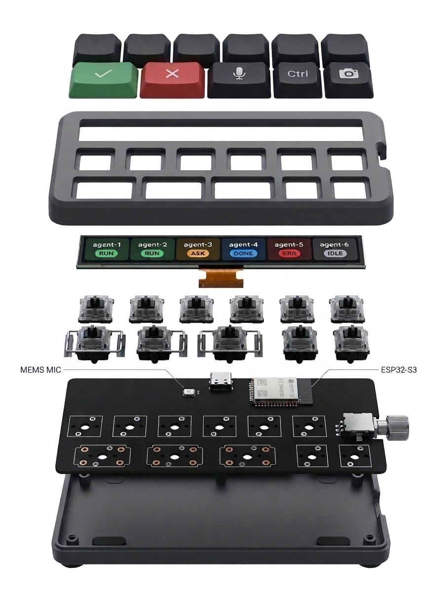
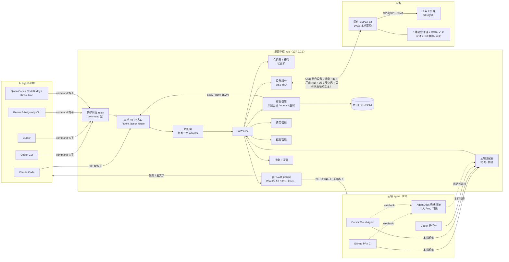
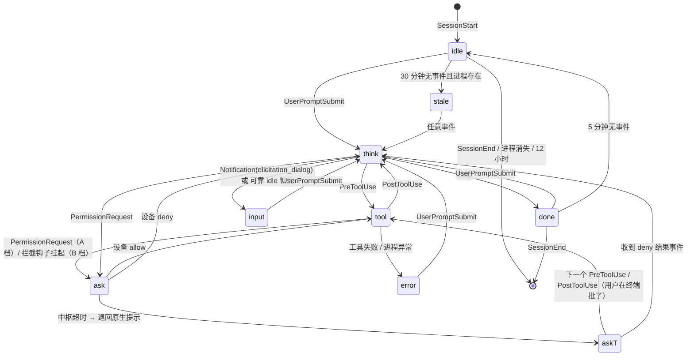
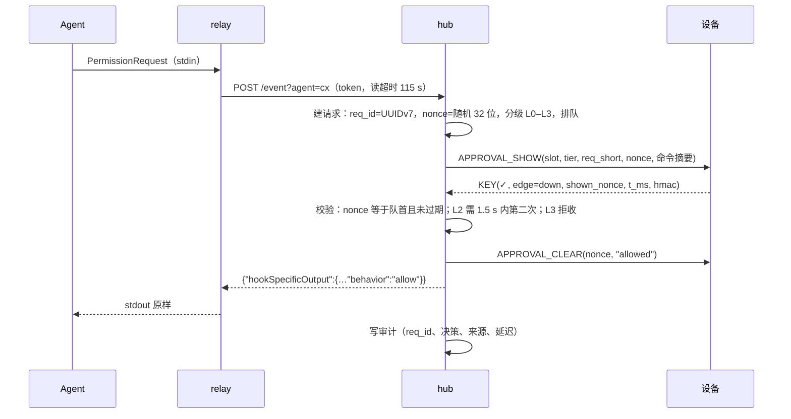
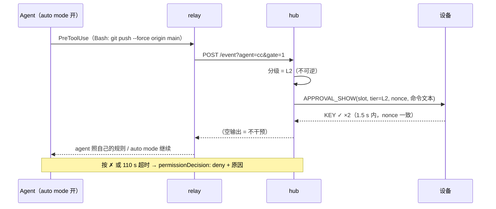

# AgentDeck（暂名）技术方案

版本 v0.2 · 2026-11-17 · 系统架构师起草。产品需求见 `06-PRD-详细版.md`。
以 `research/strategy-core.md` 第"二点六"节（审稿后决策 v2，D1–D9）为准；v2 改动的章节标了"（v2 修订）"。
标【估算】的数字没有外部来源，只用来判断量级，报价和排期前必须找供应商或实测确认；标【待实测】的接口行为只有文档依据，没有在真机上跑过。



> 注：上图是重画核对后的 v2 概念爆炸图（长条屏 + 11 颗键帽/开孔/机械轴/PCB 焊位对齐 + 3 大键卫星轴 + 注塑上下壳；旧版 `exploded-v2.png` 焊位有误已弃用），属概念示意而非实物工程图，不作为开模工程依据。

---

## 1. 总体思路（v2 修订）

1. **控制通道走官方钩子。** 批准和拒绝直接回答 agent 的 `PermissionRequest` 钩子[1][4]，不往前台窗口里打字，所以不受 Windows UIPI 和 macOS 辅助功能权限的限制[16][18]。
2. **高危操作加一道物理确认（v2，D3）。** 日常 L0/L1 命令交给 agent 自己的 auto mode；AgentDeck 用 `PreToolUse` 钩子做"高危闸门"，只拦不可逆操作，只会加一道确认，不会替 agent 放行（§6.4）。
3. **本机中枢（hub）是唯一的大脑。** 设备只负责显示和上报按键，不保存任何策略；所有判断（会话归属、风险分级、超时）都在中枢里做，方便测试和升级。设备的屏由设备自己渲染，中枢只发状态和短文本（§10）。
4. **每家 agent 一个适配器。** 钩子格式每月在变，适配层是主要的工程投入。云端 agent 也是适配器，只是数据来自轮询或 webhook（§5.4）。
5. **任何故障都退回 agent 的原生流程。** 设计上不存在"出错就放行"的路径。

---

## 2. 系统架构（v2 修订：设备改为长条屏 + RGB 会话键，去掉状态环和 v1 的 BLE，加云端来源）



**进程模型**

| 进程 | 生命周期 | 职责 |
|---|---|---|
| `agentdeck-hub` | 用户登录后常驻，崩溃后 2 秒内由托盘或系统服务管理器重启 | HTTP 入口、适配器、会话表、审批、设备、窗口控制 |
| `agentdeck-relay` | 每个钩子事件起一次 | 读 stdin，POST 给中枢，原样打印响应；出错时什么都不打印、退出码 0 |
| `agentdeck-ui` | 按需 | 托盘、浮窗、设置、审计查看；通过 `/state`（长轮询或 SSE）和 `/action` 与中枢通信 |

**技术栈**：原型阶段用 Python（标准库 `http.server`，已有 `pc/` 代码可复用）；产品阶段用 Rust 重写中枢和 relay（`tokio` + `axum` + `hidapi`；以后上 BLE 再加 `btleplug`），浮窗用 Tauri。relay 做成静态二进制，是因为 command 型钩子每个事件都要起一个进程，Python 冷启动约 40–80 ms【估算】，会吃掉延迟预算。Claude Code 和 Qwen Code 支持 http 型钩子[1][9]，可以直接 POST 到中枢，省掉起进程这一步。

---

## 3. 中枢接口

| 接口 | 说明 |
|---|---|
| `GET /health` | 不需要 token；返回版本号和设备连接状态 |
| `POST /event?agent=<id>` | 收钩子事件。普通事件更新会话表后立即返回 `{}`；需要审批的事件阻塞等待决定（见 §6） |
| `POST /action` | `{"action":"slot","n":3}`、`approve`、`deny`、`interrupt`、`cycle`、`voice`、`screenshot`、`prompt` 等；物理按键、浮窗、Stream Deck 插件、测试都走这一条路 |
| `GET /state` | 会话表、待批队列、设备状态；`?wait=<etag>` 长轮询 |
| `GET /audit?since=` | 审计查询（只给本机 UI 用） |

除 `/health` 外都要带 `X-AgentDeck-Token`。token 存在 `~/.agentdeck/token`，Windows 上用只给当前用户的 ACL，Unix 上权限 0600。中枢拒绝带 `Origin` 头的请求，并要求 `Host` 必须是 `127.0.0.1:<port>`，防止网页通过 DNS rebinding 调用本地服务。

**事件信封**：relay 给原始事件包一层，附上定位终端用的信息（只用来找窗口，不用于任何安全判断）：

```json
{
  "agent": "cc",
  "received_at": 1763371200123,
  "relay": {
    "pid_chain": [[41231,"node"],[41100,"zsh"],[40990,"tmux: server"]],
    "env": {"TMUX_PANE":"%7","TERM_PROGRAM":"tmux","WEZTERM_PANE":null,
            "KITTY_WINDOW_ID":null,"ITERM_SESSION_ID":null,"WT_SESSION":null}
  },
  "event": { "hook_event_name": "PermissionRequest", "session_id": "abc123", "...": "原样" }
}
```

---

## 4. 会话模型与状态机

**会话主键**：`(agent, session_id)`。原型里用 `cc-` / `cx-` 加去掉横线的 session_id 前 6 位作为显示 key，与已有的 `agent_lcd.hook_line` 命名一致，避免和现有钩子显示冲突。

**槽位**：第一次出现时分配最小的空槽位（1–6），之后不变；会话结束才释放；钉住的槽位保留 10 分钟；超出 6 个进入溢出列表。



**INPUT 判定**：Claude Code 的 `idle_prompt` 会在刚回答完就触发，有误报[29]。规则改为：`Stop` 之后满 60 秒没有 `UserPromptSubmit`，**并且**该会话的窗口不在前台，才进入 INPUT；`elicitation_dialog` 直接进入 INPUT。

**各家事件到状态的映射**（A/B/C 档定义见 PRD §4）：

| 状态 | Claude Code[1] | Codex[4][5] | Cursor[6] | Gemini CLI[7] / agy[8] | Qwen Code[9] | CodeBuddy[10] | Kimi[11] |
|---|---|---|---|---|---|---|---|
| 开始 | `SessionStart` | 第一个事件即开始 | 第一个事件 | `SessionStart` | `SessionStart` | `SessionStart` | 第一个事件 / `TurnStarted` |
| think | `UserPromptSubmit` | `UserPromptSubmit`【待实测】 | `beforeSubmitPrompt`【待实测】 | `BeforeAgent`【待实测】 | `UserPromptSubmit` | `UserPromptSubmit` | `UserPromptSubmit` |
| tool | `PreToolUse` | `PreToolUse` | `preToolUse` / `beforeShellExecution` | `BeforeTool` / agy `PreToolUse` | `PreToolUse` | `PreToolUse` | `PreToolUse` |
| ask | `PermissionRequest`（A） | `PermissionRequest`（A） | 拦截钩子挂起（B） | `BeforeTool` 挂起（B） | `PermissionRequest`（A 或 B，待实测） | `PermissionRequest`（A 或 B，待实测） | `PermissionRequest`（只能显示）/ `PreToolUse` 挂起（B） |
| done | `Stop` | `Stop` 或 `notify` 的 `agent-turn-complete` | `stop`【待实测】 | `AfterAgent`【待实测】 | `Stop` | `Stop` | `Stop` |
| 结束 | `SessionEnd` | 进程消失 | 进程消失 | `SessionEnd` | `SessionEnd` | `SessionEnd`【待实测】 | 进程消失 / 心跳停止 |

Kimi 有 `SessionHeartbeat` 事件，可以直接用来判断会话是否还活着[11]。

---

## 5. 适配层（v2 修订：Codex 钩子信任、高危闸门、安装自检、新增 §5.4 云端 agent）

### 5.1 接口

```text
trait Adapter {
  id() -> "cc" | "cx" | "cursor" | "gemini" | "agy" | "qwen" | "codebuddy" | "kimi" | "trae"
  tier() -> A | B | C                          // 可按版本探测结果动态降级
  parse(raw_event) -> NormalizedEvent          // 统一成 {kind, session, cwd, tool, command, ...}
  needs_decision(ev) -> bool
  render_allow(req) / render_deny(req, msg) / render_fallback(req) -> stdout bytes
  hook_timeout_s() -> 写进配置的钩子超时
  install_plan(home) / uninstall_plan(home) -> 对配置文件的增删（幂等）
  probe_version() -> 版本号，用于矩阵和金丝雀测试
}
```

`render_fallback` 是关键：A 档返回空结果（agent 走原生提示）；B 档按各家语义返回"回到原生弹窗"或 deny，绝不返回 allow。

### 5.2 各家细节

**Claude Code（A 档，P0）**[1][2]
- 配置：`~/.claude/settings.json` 的 `hooks`；只写用户级。
- 事件：`SessionStart`（matcher `startup/resume/clear/compact/fork`）、`UserPromptSubmit`、`PreToolUse`、`PostToolUse`、`Notification`（`permission_prompt`、`idle_prompt`、`elicitation_dialog`）、`PermissionRequest`、`Stop`（带 `last_assistant_message`）、`SessionEnd`。
- 应答：`{"hookSpecificOutput":{"hookEventName":"PermissionRequest","decision":{"behavior":"allow"}}}`；拒绝用 `behavior:"deny"`，带 `message`，长按 ✗ 时加 `interrupt:true`。
- 不返回 `updatedInput`（设备不改写命令）。不使用 `permission_suggestions`（不做"一直允许"）。
- 钩子 timeout 设 120 s（默认 600 s）。超时或失败时输出被丢弃，回到原生弹窗，这是天然的 fail-safe。
- `PermissionRequest` 不能靠退出码拒绝，必须输出 JSON。
- 优先用 http 型钩子：`{"type":"http","url":"http://127.0.0.1:47800/event?agent=cc","headers":{"X-AgentDeck-Token":"$AGENTDECK_TOKEN"},"allowedEnvVars":["AGENTDECK_TOKEN"]}`。字段名以官方文档为准，安装器先读文档版本再写。
- 自己拉起的会话（headless / Agent SDK）用 `--permission-prompt-tool` 或 `canUseTool` 回调接管，路线图 P2[2]。
- （v2）高危闸门：另装一个 `PreToolUse` 钩子（matcher 限 `Bash`、MCP 写类工具、编辑敏感路径），语义见 §6.4。
- （v2）真会话测试和用户使用都要求本机 `claude` 命令行已登录；桌面版 Claude 的登录凭据不共用（我们的端到端测试就遇到过 `Not logged in`）。安装器只检测、提示，不代填凭据。

**Codex CLI（A 档，P0）**[4][5]
- 配置：`~/.codex/hooks.json` 或 `config.toml` 的 `[hooks]`；项目级钩子只有 `.codex/` 被信任时才加载。我们只写用户级。
- 事件：`PermissionRequest`（输入含 `turn_id`、`tool_name` 为 `Bash` / `apply_patch` / `mcp__server__tool`、`tool_input.command`、`tool_input.description`）、`PreToolUse`、`Stop`；`notify` 只有 `agent-turn-complete`。
- 应答结构同 Claude Code；**不能**返回 `updatedInput`、`updatedPermissions`、`interrupt`（文档说这些字段目前 fail closed）。
- 多个钩子时任何一个 deny 就是 deny，所以我们的 allow 不会压过公司策略钩子。
- 打断：deny 之后另外发 Esc（tmux `send-keys` 或聚焦后由设备键盘接口发送）。
- （v2）**钩子信任**：官方文档写明"new or changed hooks are marked for review and skipped until trusted"[4]。也就是说安装器写进去的钩子，在用户于 Codex 里用 `/hooks` 手动信任之前**一条都不会执行，而且没有报错**（我们的端到端测试里 relay 日志一条记录都没有，就是这个原因）。处理：
  - 安装器不使用任何跳过信任的参数（例如 `--dangerously-bypass-hook-trust`），信任必须由用户本人做；
  - 引导页提示用户输入 `/hooks` 信任；
  - hub 记录"首次看到 Codex 进程的时间"（进程扫描）和"最近一次 `cx` 事件时间"，看到进程 10 分钟仍没有任何 `cx` 事件，就在托盘和设备屏上提示"Codex 钩子未生效"；
  - 安装器升级时如果改了 Codex 钩子条目，diff 预览里标"需要重新信任"。
- （v2）`codex exec` 非交互模式不允许提权，永远不会触发 `PermissionRequest`；这类会话只能显示状态。
- （v2）高危闸门：`PreToolUse` 返回 deny 可以阻断工具调用；"不干预"就是不输出。Codex 的 `PreToolUse` 能拦哪些工具（`Bash`、`apply_patch`、MCP）以官方文档和实测为准【待实测】。
- 现状：hub（v1–v1.4）已实现 Codex 格式的 `PermissionRequest` 应答，并用真实 relay/hub 进程验证（allow、L2 两次确认、L3 锁死、deny、hub 离线时静默）；还没在真实 Codex 会话里跑过（等用户信任钩子）。

**Cursor（B 档，P1）**[6]
- 配置：`~/.cursor/hooks.json`。
- 事件：`beforeShellExecution`（输入 `command`、`cwd`、`sandbox`）、`beforeMCPExecution`、`preToolUse` 等。
- 输出：`{"permission":"allow"|"deny"|"ask","user_message":"...","agent_message":"..."}`；退出码 2 等于 deny；输出不是合法 JSON 会阻断；其他退出码视为钩子失败、默认放行，可设 `failClosed: true`。
- 策略：默认只读状态（不挂审批）；用户开启 B 档后，钩子挂起等设备，超时返回 `ask`（回到 Cursor 自己的弹窗），并设 `failClosed: true`。钩子超时上限文档里没找到，先按 50 s 设计【待实测】。

**Gemini CLI（B 档仅 deny，P1）**[7]
- 配置：`~/.gemini/settings.json` 的 `hooks`，只支持 `type:"command"`；默认超时 60000 ms。
- `BeforeTool` 可返回 `decision:"deny"`（`block` 是别名），必须带 `reason`；没有找到 `ask`；`Notification` 只能看，不能放行或拦截。
- **风险**：stdout 不是纯 JSON 时默认放行。适配器只输出一个 JSON 对象；relay 出错时也要输出 deny（这是唯一一个"出错时 relay 必须输出内容"的 agent），由 relay 内置的最小逻辑完成，不依赖中枢。
- 面向个人用户的服务 2026-06-18 起转到 Antigravity CLI，所以只服务企业和 API 用户。

**Antigravity CLI `agy`（B 档，P1）**[8]
- 钩子写在工作区 `.agents/hooks.json`（插件形式在 `~/.gemini/antigravity-cli/plugins/<name>/hooks.json`）；`PreToolUse` 对应 Gemini 的 `BeforeTool`，`run_command` 对应 `run_shell_command`；stdin 读 JSON，stdout 返回 `{"decision":"allow"|"deny"}`。
- 公开版 IDE 和桌面版不执行钩子，只有 CLI 执行。
- 我们用插件目录做用户级安装，避免写进用户的仓库【待实测】。

**Qwen Code（A 或 B，P1）**[9]
- 23 个事件，含 `PermissionRequest`（"权限弹窗出现时"触发）、`Notification`、`Stop`；支持 command 和 HTTP 型钩子；项目钩子需要用户批准该配置或信任该目录。
- Gemini CLI 分叉，但事件命名跟 Claude Code 风格。**`PermissionRequest` 能否代答需实测**：实测通过前，按 B 档用 `PreToolUse` 拦截。

**CodeBuddy Code（A 或 B，P1）**[10]
- 27 个事件，含 `PermissionRequest`、`Notification`（`permission_prompt`、`idle_prompt`、`auth_success`）、`Stop`、`SubagentStop`、`PreCompact`、`SessionStart`、`Elicitation`；配置格式与 Claude Code 相近（`~/.codebuddy/settings.json`），项目目录变量是 `CODEBUDDY_PROJECT_DIR`。
- 钩子仍是 Beta。**能否代答需实测**；`PreToolUse` 可阻断，作为 B 档兜底。

**Kimi Code CLI（C / B，P1）**[11]
- 配置：`~/.kimi/config.toml` 的 `[[hooks]]`（`event`、`matcher`、`command`、`timeout`）。
- 20 个事件，含 `PermissionRequest`（在等待批准前触发，**不能阻断**）、`PermissionResult`、`Interrupt`、`SessionHeartbeat`、`Notification`、`TurnStarted`。
- 所以 ASK 状态可以显示，但不能代答。需要设备决策时，只能用 `PreToolUse` 拦截，返回 `{"hookSpecificOutput":{"hookEventName":"PreToolUse","permissionDecision":"deny","permissionDecisionReason":"..."}}`。
- 文档写明钩子失败时放行（fail-open）。B 档下 relay 必须自己保证超时后输出 deny，不能依赖 Kimi 的默认行为。
- 社区 issue #2337 报告过审批弹窗不触发任何钩子，后续文档已列出 `PermissionRequest`；以实测为准。

**Trae IDE（待核，P1 调研 / P2 上线）**[12]
- 有 Hooks（设置 → Hooks，分全局和项目），支持"从 Claude Code 导入 hooks"；已确认有 `PreToolUse` / `PostToolUse`；完整事件表和是否有可代答的审批事件**还没核实**。
- IDE 形态只能做到窗口级定位；Trae CLI 有没有钩子没找到。对外不承诺支持审批。

**只读兜底（C 档）**：不支持钩子的工具（例如原型里的 DeepSeek harness）用读日志或看窗口标题的方式显示状态，原型的 `dsh_watch.py` 就是这一类。

### 5.3 安装器规则（v2 修订）
- 只写用户级配置；写之前备份为 `*.bak-agentdeck-<时间>`；幂等；卸载只删带 `agentdeck` 标记的条目；`--dry-run` 只打印 diff。
- 不改动已有的第三方钩子（包括原型的 `agent_lcd` 钩子）。
- 安装和每次启动时扫描当前仓库的项目级钩子，发现与 AgentDeck 冲突的（例如项目级 `PermissionRequest` 钩子会先于我们给出 allow），在浮窗里提示。
- （v2）**安装后自检清单**，结果显示在设置页的"Agent"分组：

| 检查 | 方法 | 不通过时 |
|---|---|---|
| Claude Code 命令行已登录 | 检测 `claude` 可执行文件，再用一个无副作用的方式确认登录状态（具体命令以官方 CLI 文档为准）【待实测】 | 提示"在终端运行 `claude` 完成登录"；不代填 |
| Claude Code 钩子生效 | 安装后第一个 `cc` 事件到达即通过 | 30 分钟内看到 `claude` 进程却没有事件 → 提示检查 settings.json |
| Codex 钩子已信任 | 看到 Codex 进程后 10 分钟内收到任意 `cx` 事件 | 提示"在 Codex 里输入 /hooks 信任 AgentDeck" |
| `gh` 已登录（可选，云端槽位） | `gh auth status` | 提示登录或填只读 token |

### 5.4 云端 agent 适配器（P1，v2 新增，D3）

云端 agent 跑在别人的容器里，本机没有进程、也不会调本地钩子，所以没有 `pid_chain`、没有审批[31][32]。适配器只做两件事：拿状态，给出"按下要打开的链接"。

| 来源 | 免费版（本机） | 个人 Pro（云端桥接） | 归一化后的状态 | 按下 |
|---|---|---|---|---|
| GitHub PR / CI | 用本机 `gh` 的登录或用户填的只读 token，调用 GitHub REST / GraphQL：请我 review 的 PR、我开的 PR 的检查结果；每 60 s 轮询，带 ETag 条件请求省配额 | 用户安装我们的 GitHub App，webhook（`pull_request`、`check_suite`、`workflow_run` 等）打到桥接，再推给 hub | `REVIEW` / `CI ✗` / `READY` / `CLOUD·RUN` | 浏览器打开 PR 或失败的检查 |
| Cursor Cloud Agent | 用 Cursor 提供的 agent 接口查询任务列表和状态（用户的 API key 存系统钥匙串）；轮询 60 s | 如果官方支持 webhook，接到桥接 | 运行中 / 完成待 review / 失败 | 打开任务页或它开的 PR |
| Codex 云任务 | 用 Codex 官方的云任务列表能力（CLI 子命令或接口）轮询 | 视官方能力而定 | 同上 | 打开任务页 |

- Cursor、Codex 云端接口的名字、鉴权方式、有没有 webhook，文档里还没核实，**全部【待实测】**；做不到就只做 GitHub（它的接口是确定的）。
- **云端桥接的安全边界**：hub 主动建立出站 WebSocket（TLS）到桥接，桥接只下发 `{source, id, state, title, url}` 这类状态元数据；hub 不接受来自桥接的任何动作（审批、文字、按键）。没订阅或断网时自动退回本机轮询。
- 云端槽位的 ✓ / ✗ 无效，hub 收到时提示"云端任务请在网页处理"并打开链接。
- 打开浏览器：Windows `ShellExecute`、macOS `open`、Linux `xdg-open`；只打开适配器给出的 `https://` 链接，并校验域名在该来源的白名单里（`github.com`、`cursor.com`、`chatgpt.com` 等），防止被注入任意链接。

---

## 6. 审批协议（v2 修订：新增 §6.4 高危闸门）

### 6.1 时序



### 6.2 规则

| 规则 | 内容 |
|---|---|
| 标识 | `req_id` 用 UUIDv7，写审计；`nonce` 每条请求随机 32 位，只在中枢和设备之间流转；设备按键报文必须带"按下那一刻屏上显示的 nonce" |
| 单次有效 | 一个 nonce 只能产生一次决定；决定后立即作废 |
| 队列 | 先到先显示；审批区切换后 300 ms 内不接受 ✓；同一会话的多条请求按顺序显示 |
| 超时 | 中枢 110 s < relay 读超时 115 s < 钩子超时 120 s。三层递增，保证中枢先超时，并给出明确的回退结果，而不是由 agent 杀掉钩子 |
| L2 | 第一次 ✓ 只把状态改为"待确认"并更新屏幕；1.5 s 内第二次 ✓ 且 nonce 相同才放行；超时重新开始 |
| L3 | 设备的 ✓ 和浮窗按钮都拒收；只接受 ✗、跳转，或者用户在终端里自己处理 |
| 来源 | `usb_key` 可以放行 L1–L2；`overlay` 和 `action_api` 只能放行 L1；`cloud_bridge` 什么都不能放行（v2）。以后上 BLE 时：`ble_key` 默认只能拒绝（开启 BLE 审批后可放行 L1） |
| 设备心跳 | 中枢每 1 s 发心跳；设备 3 s 没收到就显示"中枢离线"，本地不再上报 ✓；中枢 3 s 没收到设备消息就把设备标为离线，新请求直接走回退 |
| 风险分级 | 解析原始命令：拆管道、`&&`、`;`、子 shell；识别 `bash -c`、`sh -c`、`eval`、`powershell -EncodedCommand`、`base64 -d \| sh`，并把解码或解包后的内容再分级；无法解析的按 L2；分级器出错按 L2 |

### 6.3 fail-closed 规则（硬约束，有测试覆盖）

1. 没有一次通过校验的设备按键，中枢永远不会输出 allow。
2. relay 在任何异常下：A 档什么都不输出、退出码 0；B 档输出该 agent 的"回到原生弹窗"或 deny。
3. 中枢重启时，内存里的待批请求全部丢弃，对应的 relay 连接断开，按第 2 条处理。
4. 设备不能自己发起放行：固件里没有"自动批准"的代码路径；按键报文只是输入，由中枢判断。
5. 风险规则文件损坏或签名不对（团队版）时，退回内置的最严规则（所有 Bash 都按 L2）。
6. （v2）高危闸门在任何异常下都返回 deny（它是我们主动加的拦截，出错时不能变成"没拦"）；只有分级结果明确是 L0/L1 时才不输出。

### 6.4 高危闸门：Hardware 2FA for Agents（v2 新增，D3）

**为什么要有**：Claude auto mode 2026-08-14 起默认开启，官方分类器拦下 89% 的危险操作，人工审查只拦下 13.6%[30]。这意味着 `PermissionRequest` 会越来越少，只靠它，设备在 auto mode 用户那里几乎没活干；而不可逆操作恰恰是"分类器放行了，但人想再看一眼"的那类。闸门让设备在 auto mode 打开时依然管住这一小撮操作。

**机制**（Claude Code、Codex 首发；其他 agent 的 B 档拦截本来就是同一个思路）：



| 规则 | 内容 |
|---|---|
| 默认拦截范围 | L2 / L3：`git push` 到受保护分支（默认 main / master / release/*）或带 `--force`；`git reset --hard`；`rm -rf`；用户列表里的生产主机 `ssh`、生产 kube context 的 `kubectl apply/delete/exec`、`terraform apply/destroy`、`helm upgrade`；数据库写操作（`DROP` / `DELETE` / `UPDATE` / `ALTER` / 迁移命令）；写 `.env`、密钥文件、`~/.ssh`；`gh pr merge`；MCP 写类工具（按名单） |
| 不拦 | L0 / L1 立即返回空，不增加任何延迟以外的影响（relay 一次本地 HTTP 往返，目标 < 20 ms【估算】） |
| 只加不减 | 确认后返回空（不干预），而不是 `allow`，所以 agent 的 deny 规则和 auto mode 的判断照常生效；我们永远不会因为闸门而放行 agent 本来要拒绝的操作 |
| 与 `PermissionRequest` 叠加 | auto mode 关着时，同一命令可能先过闸门、再被 agent 自己问一次。hub 用 `(session, tool_input 哈希)` 记住 30 s 内刚确认过的命令，`PermissionRequest` 到来时审批卡标"已在闸门确认"，仍要按一次 ✓（不自动放行）【待实测体验】 |
| 可配置 | 接管范围：只拦 L2/L3（默认）/ L1 起 / 关闭闸门；生产环境识别列表；Team 版可下发并锁定 |
| 现状 | hub 已有 low/high 两级分级和 high 的两次确认（v1），L3 极危锁死和哈希链审计（v1.1），均用真实进程验证；v1.4 已实现 `PreToolUse` 闸门（两次 ✓ 返回 `{}`、✗ / 超时 deny、30 s 去重、`install --gate`；闸门失败路径只在 hub 不在时拦 high / critical），用真实进程和真实系统热键（F19/F20）验证，真实 auto mode 会话待测；nonce 校验未做 |

**为什么这算 Hardware 2FA**：第一因子是 agent 自己的判断（auto mode / 规则），第二因子是人在一块独立 USB 设备上的物理按键；按键报文带屏上显示的 nonce（§6.2），而且决定走钩子而不是键盘输入，前台焦点在哪里都不影响。

---

## 7. 窗口与终端控制

### 7.1 定位一个会话的窗口（按优先级尝试）

1. **用户手动绑定**（长按会话键时把当前前台窗口绑给它），记住 `(cwd, agent) → 窗口特征`。
2. **终端自己的接口**（最准，能定位到标签页或 pane）：
   - tmux：`TMUX_PANE` → `tmux select-window -t <pane>` + `select-pane -t <pane>`，再把 tmux 所在的终端窗口提到前台。
   - WezTerm：`WEZTERM_PANE` → `wezterm cli activate-pane --pane-id <id>`。
   - kitty：`KITTY_WINDOW_ID` → `kitty @ focus-window --match id:<id>`（需开启远程控制）。
   - iTerm2：`ITERM_SESSION_ID` → AppleScript 选中对应 session。
   - VS Code / Cursor 集成终端：`code -r <cwd>` / `cursor -r <cwd>` 把对应工作区窗口提到前台；终端标签页的精确定位放到 P2（通过我们的 VS Code 扩展）。
3. **进程树**：relay 上报的 `pid_chain` 向上找第一个有顶层窗口的进程（Windows 上是 `WindowsTerminal.exe`、`conhost.exe`、`Code.exe` 等）。
4. **标题匹配**：窗口标题里含 cwd 的目录名或 agent 名。这是原型 `daemon.py` 现在的做法。

### 7.2 各操作系统

| 系统 | 切到前台 | 限制与对策 |
|---|---|---|
| Windows | `SetForegroundWindow` 有前台锁，配合 `AllowSetForegroundWindow` / `AttachThreadInput` / 先发一次 Alt 的常见做法（原型 `deck_windows.WindowControl` 已实现）；最小化的窗口先 `ShowWindow(SW_RESTORE)` | Windows Terminal 多标签无法用 Win32 选中标签，用 `wt.exe -w <id> focus-tab -t <index>`【待实测】；目标是管理员进程时 `SendInput` 会被 UIPI 静默拦截[16]，改由设备的键盘接口直接发按键（硬件按键不受 UIPI 限制） |
| macOS | `NSRunningApplication.activate` + AX API 对窗口 `AXRaise` | 需要"辅助功能"权限；监听全局输入还需要"输入监控"权限，撤销辅助功能时如果有活动的 event tap 可能卡住输入[18]。我们不装 event tap，设备按键走厂商 HID 接口，不需要输入监控 |
| Linux X11 | EWMH `_NET_ACTIVE_WINDOW`（等同于 `wmctrl -ia`），按 `_NET_WM_PID` 找窗口 | 无特殊限制 |
| Linux Wayland | 没有通用接口：sway `swaymsg '[pid=N] focus'`，Hyprland `hyprctl dispatch focuswindow pid:N`，KDE 用 KWin 脚本（D-Bus），GNOME 需要装我们的 Shell 扩展 | tmux / WezTerm 定位不受影响；其他情况降级为"只显示，不切换"并提示 |

### 7.3 向会话发送文字和按键（语音、模板、打断）

按优先级：
1. tmux `send-keys` / WezTerm `cli send-text` / kitty `@ send-text`：不需要切前台，最准。
2. 切到前台后**由设备的 HID 键盘接口**发送"粘贴 + 回车"（中枢通过 `KBD_EMIT` 让设备打字）。硬件按键在系统看来就是真键盘，不受 UIPI 和 macOS 辅助功能的限制[16][18]。粘贴快捷键按目标区分：Windows Terminal / VS Code 用 Ctrl+V，Linux 终端用 Ctrl+Shift+V，macOS 用 Cmd+V。
3. 最后才用系统注入（`SendInput` / `CGEventPost` / `uinput`[17]）。

发送前检查：目标窗口确实在前台（发送前 50 ms 再读一次前台窗口），否则放弃并提示，避免打进错误的窗口。会话处于 ASK 状态时拒绝发送文字。

---

## 8. 语音管线（v2 修订）

| 阶段 | 方案 | 说明 |
|---|---|---|
| P1-a（2027-01） | 系统听写：Windows `Win+H`，macOS 听写快捷键；Claude Code 会话可选它内置的 `/voice`（按住空格）[27]，设备在按住麦克风键期间通过键盘接口按住空格 | 零模型、零下载；Linux 没有系统听写，直接用 P1-b |
| P1-b（2027-03） | 本地 sherpa-onnx 流式 Zipformer（有约 2000 万参数的小模型，支持 Windows）[22] | 中英双语模型、模型 50–300 MB 按需下载【估算】；whisper.cpp 不是流式，要分块，小模型在部分设备上慢于实时[23]，只作离线精修备选 |
| P2 | 云端（用户自己的 Key：OpenAI / Azure / 讯飞 / 阿里） | 默认关闭；开启时浮窗明确提示"音频会上传" |

**流程**：麦克风键按下 → 锁定目标会话、开始采集（设备板载麦克风作为 USB 音频设备，或电脑默认麦克风）→ 屏上对应格子显示 `● REC` → 松开 → 识别结束 → 浮窗预览 1.5 s（✗ 取消）→ 按 §7.3 的通道发送，默认不回车。
**指标**：松开到文字出现 p50 ≤ 800 ms（本地流式，15 s 以内的语音）【估算，需实测】。

**（v2）现状与 Demo 差距**：hub 的语音只是"聚焦目标窗口后按 Win+H"（v1.2 加了按住期间每 100 ms 把前台切回目标窗口的守护，真实听写未验证，仍有最多 100 ms 空档），系统听写会把字打进**当前前台窗口**，录音中途焦点被抢就会打错地方。必须改成 hub 自己采集和识别，松开后再按 §7.3 向锁定的会话发送。

**（v2）个人 Pro：懂代码的语音纠错**（D4）
1. 热词表：按下说话键时，hub 在本地扫描目标会话 `cwd` 下的文件名、目录名、`git` 分支名，以及用轻量解析（ctags 一类）抽出的函数 / 类名，按最近修改时间取前 N 个（例如 2,000 个）【估算】。只取名字，不读代码内容。
2. 识别：本地 sherpa-onnx 用热词偏置（它支持 hotwords / contextual biasing[22]）；云端识别时把热词表作为提示一起发送（用户主动开启，界面明确提示"音频和热词会上传"）。
3. 纠错：识别结果和热词表做读音 + 拼写的模糊匹配，把"session store 点 rs"改成 `session_store.rs`；改动在预览里高亮，用户可以按 ✗ 撤销。
4. 指标：在 50 条中英混杂、带标识符的录音样本上，标识符正确率对比系统听写【待实测】。

---

## 9. 截图管线（P2）

1. 截图键单击 → 中枢截取当前活动窗口（Windows 用 `PrintWindow` / DXGI，macOS 用 ScreenCaptureKit，需要"屏幕录制"权限，X11 用 XGetImage，Wayland 走 xdg-desktop-portal Screenshot）。
2. 存为 `~/.agentdeck/shots/<时间>-<会话>.png`，长边超过 2000 px 时缩小（控制 agent 的 token 消耗）。
3. 把文件路径用 §7.3 的方式粘贴进选中的会话，不回车。Claude Code、Codex 都能按路径读取本地图片（Codex 读取方式【待实测】）。
4. 长按 = 浮窗框选；Ctrl + 单击 = 全屏。
5. 默认保留 7 天后删除；截图永远不上传。

---

## 10. 设备协议（v2 修订，D1：长条屏由设备自己驱动和渲染，主机只发状态和短文本）

### 10.0 硬件结构与显示链路

```
主机 hub ──USB 全速 HID（状态 + 短文本，≤ 64 B/报文）──▶ ESP32-S3
                                                         │ LVGL 在 PSRAM 帧缓冲里渲染
                                                         ├─ SPI/QSPI + DMA ──▶ 3.2–3.5" 长条 IPS（6 等分）
                                                         ├─ RMT ──▶ 9 颗 RGB（6 会话键 + ✓/✗/说话背光）
                                                         ├─ 键矩阵 / GPIO ◀── 6 矮轴 + ✓ ✗ 说话 + Ctrl 截图
                                                         ├─ PCNT ◀── 滚轮编码器
                                                         └─ I2S/PDM ◀── MEMS 麦克风 → UAC2
```

- **屏**：候选 3.49 寸 172×640 长条 IPS（QSPI 接口，驱动 IC `AXS15231B`，工业裸屏样品价 $6.90–11.50/片，微雪同款开发板 `ESP32-S3-Touch-LCD-3.49` 约 $30，见 `research/raw-gemini-supply.md`；量产阶梯价待询价）。每格约 106×172 像素。整屏帧缓冲 640×172×2 B ≈ 220 KB，放在 N8R8 的 8 MB PSRAM 里双缓冲（注：`AXS15231B` 在 QSPI 模式下不支持硬件横竖屏旋转，需在 PSRAM 做软件转置后整屏刷新，已在 `firmware/strip349/` 草稿中按此实现，真板【待实测】）。
- **刷新**：QSPI 40 MHz 理论约 20 MB/s，整屏一帧约 11 ms，单格（约 37 KB）约 2 ms【估算】；只刷变化的格子。动画（闪烁、呼吸）由设备本地按状态做，不需要主机参与。
- **字库与图标**：agent 图标、状态图标、数字、拉丁字符和常用汉字（GB2312 一级约 3,755 字，16/24 px 两档）存在 flash 里【估算 300–600 KB】；字库里没有的字显示为 `□`，主机侧在标签里尽量用拼音或英文缩写兜底。
- **RGB 灯**：每颗会话键下一颗反贴 RGB LED（SK6812 一类，矮轴常用的反贴封装）【估算，具体料号待定】，由 RMT 驱动；颜色、闪烁模式由设备按状态本地生成。
- **否决方案**：v0.1 的"6 块独立 0.85 寸 128×128 屏，主机推每块屏的像素帧"。问题是：6 块屏 BOM 约 $36（1k 台）；6 根片选 + 6 条 FPC 的结构和良率；以及主机经 USB HID 推帧，6 键全刷约 0.9 s（下面 §10.3 有对比）。

### 10.1 USB 复合设备

| 接口 | 类型 | 用途 |
|---|---|---|
| IF0 | HID 键盘（boot 协议，8 字节报文） | 不装软件时每个键发 F13–F24 等键码；中枢要求时代为打字（`KBD_EMIT`） |
| IF1 | 厂商自定义 HID，usage page `0xFF61`、usage `0x01`；IN / OUT 各 64 字节，中断端点 1 ms | AgentDeck 协议。不用 QMK 默认的 `0xFF60`[13]，避免和 QMK / VIA 工具冲突 |
| IF2 | USB 音频（UAC2 麦克风，16 kHz 单声道 16 bit） | 按住说话（v2：板载麦克风已定） |
| IF3（仅工程版） | CDC 串口 | 调试日志；量产版关闭 |

厂商 HID 接口不在 Chromium 的 WebHID 黑名单里（黑名单拦的是键盘、鼠标等标准接口），以后可以做网页版配置工具[14][15]。VID/PID：EVT 阶段先申请 Espressif 的子 PID【待核实】，量产前评估是否自购 USB-IF VID。

### 10.2 报文格式（IF1，64 字节）

```
字节 0   type
字节 1   seq（每方向各自递增，ACK 回显）
字节 2   flags：bit0 需要 ACK，bit1 还有后续分片，bit2 带 HMAC
字节 3   len（有效载荷长度，≤ 60）
字节 4–63 payload
```

| 方向 | type | 名称 | payload |
|---|---|---|---|
| 设备→主机 | 0x01 | HELLO | 协议版本、固件版本、硬件版本、能力位图（屏 / 麦 / BLE / 环）、device_id（8 字节） |
| 设备→主机 | 0x02 | KEY | key_id、edge（down / up）、t_ms（4 字节设备时间）、修饰键状态、shown_nonce（4）、hmac（8，截断的 HMAC-SHA256） |
| 设备→主机 | 0x03 | WHEEL | delta（int8）、按下状态、t_ms |
| 双向 | 0x04 | ACK / NACK | 回显 seq、错误码 |
| 设备→主机 | 0x05 | LOG | 级别 + UTF-8 文本 |
| 主机→设备 | 0x10 | SLOT_SET | slot、state、agent_icon（图标 id）、color（RGB565，同时决定会话键灯色）、led_mode（常亮 / 闪 / 快闪 / 呼吸）、badge、since_s（状态开始时刻，设备自己算持续时间）、label（UTF-8，≤ 36） |
| 主机→设备 | 0x11 | APPROVAL_SHOW | slot、tier、req_short（2）、nonce（4）、ttl_s、分片序号 / 总数、命令文本分片（命令全文最多 240 字节，超出由主机截断并加 `…`）。设备收到完整一条后切到"审批视图"（整条屏显示命令，6 格缩成顶部状态条） |
| 主机→设备 | 0x12 | APPROVAL_CLEAR | nonce、原因（allowed / denied / timeout / fallback）；设备回到 6 格视图 |
| 主机→设备 | 0x13 | APPROVAL_HINT | nonce、提示 id（"再按一次确认""禁止设备放行""没有待批"等，字串存在设备里） |
| 主机→设备 | 0x14 | ICON_PUT | 图标 id、宽高（≤ 48×48）、分片；写进 flash 的用户图标区。只在新增 agent 图标或升级时用，很少发生 |
| 主机→设备 | 0x16 | DISPLAY_CFG | 亮度、主题、勿扰时段（替代 v0.1 给状态环用的 RING） |
| 主机→设备 | 0x17 | KBD_EMIT | 最多 12 步（修饰键、键码、按住毫秒）；只允许在心跳正常时执行 |
| 主机→设备 | 0x18 | TEMPLATE_LABELS | 6 条模板名；按住 Ctrl 时设备本地显示，不用等主机 |
| 主机→设备 | 0x1F | TIME_SYNC / HEARTBEAT | 主机时间、心跳序号 |

v0.1 的 `FRAME_BEGIN / DATA / END`（主机推像素帧）和 `RING` 已删除。

**按键手势在主机端识别**（单击、双击、长按），设备只报边沿和设备时间戳。这样手势逻辑能离线测试，USB 抖动也不影响时间判断；唯一例外是 Ctrl 按住时的模板名显示，在设备本地完成。

### 10.3 带宽预算（v2 重算）

链路容量：全速 USB 中断端点每毫秒 1 个 64 字节报文，约 64 KB/s，实际载荷 60 B × 1,000 = 60 KB/s。

| 场景 | 报文 | 数据量 | 在 1 ms 间隔下的耗时 |
|---|---|---|---|
| 一个会话状态变化 | 1 个 `SLOT_SET` | 64 B | 1 ms |
| 6 个槽位同时变化（开机、重连） | 6 个 `SLOT_SET` | 384 B | 6 ms |
| 一条审批（命令 240 字节） | 5 个 `APPROVAL_SHOW` 分片 | 320 B | 5 ms |
| 持续时间、闪烁、呼吸 | 0（设备本地算） | 0 | — |
| 心跳 | 每秒 1 个 | 64 B/s | — |
| 新增一个 48×48 图标（很少） | 约 80 个 `ICON_PUT` | 约 4.6 KB | 约 80 ms |

- 正常使用时平均流量 < 1 KB/s，峰值（重连 + 一条审批）约 11 个报文 / 11 ms，**占用率不到链路的 2%**【估算】。
- 状态事件到屏上更新的延迟主要在设备渲染：单格局部刷新约 2 ms、审批视图整屏约 11 ms【估算】，满足 PRD 的 p95 < 200 ms。
- **对比 v0.1**：主机给 6 块 128×128 屏推像素，一帧 64×64（设备再放大）就要 147 个报文，6 键全刷约 0.9 s，只能靠图标库、RLE、2 倍放大、加 bulk 端点一层层补救。v2 把渲染挪到设备上，这些补救都不需要了，也不需要 bulk 接口。
- BLE 以后上时，同一套报文的流量（< 1 KB/s）对 BLE 也毫无压力，不用像 v0.1 那样在无线模式下"降刷新"。

### 10.4 BLE GATT（v2 修订：v1 不做，留给以后的无线版）

> v1 只做 USB-C 有线（D1）。ESP32-S3 本身带 BLE，硬件不用改；下面是以后做无线版时的设计草案，不在 v1 固件里开启。状态环不在 v1（PRD §3.9）。

| 特征 | 属性 | 内容 |
|---|---|---|
| `AD01` Control | Write（有响应） | 配对挑战与应答、能力协商 |
| `AD02` HostToDevice | Write Without Response | 与 USB 相同的报文格式（去掉 64 字节补齐），可分片 |
| `AD03` DeviceToHost | Notify | KEY / WHEEL / ACK / LOG |
| `AD04` IconPut | Write Without Response | 图标上传分片（v2：不再传像素帧） |

- 128 位自定义服务 UUID；MTU 协商到 247，开启 DLE【估算吞吐 50–100 KB/s】。
- 要求 LE Secure Connections 绑定。HMAC 密钥在设备**第一次插 USB 时**通过 USB 下发（带外配对，避免 BLE 空中配对被劫持）。
- （以后如果做状态环配件）状态环连接到设备（设备做 BLE central），而不是连电脑。这样电脑没有蓝牙也能用，环的配对一次完成。环只接收 `RING` 报文，不能发起任何操作，只有"轻触 = 跳转最紧急会话"一个事件。
- 是否同时兼容 Anthropic 官方的桌宠 BLE 协议[26]，作为待定项。

---

## 11. 固件（v2 修订）

### 11.1 主控选型

| 项 | ESP32-S3 | nRF52840 | RP2040 |
|---|---|---|---|
| USB | 原生全速 OTG，TinyUSB（HID + UAC + CDC 复合） | 原生全速 | 原生全速，TinyUSB |
| 无线 | BLE 5 + Wi-Fi | BLE 5，低功耗最好 | 无，需外挂 |
| 内存 | 512 KB SRAM + 可选 PSRAM（R2 / R8） | 256 KB | 264 KB |
| 驱一条 QSPI 长条屏（v2） | 够，PSRAM 放 220 KB 帧缓冲还能双缓冲 | 吃紧（RAM 放不下整帧） | RAM 放不下整帧，要分块渲染 |
| SDK | ESP-IDF + NimBLE + LVGL | Zephyr / nRF Connect SDK | Pico SDK |
| 认证 | 有预认证模块 | 有预认证模块 | 无射频，最简单 |
| 价格 | 模块 1 片约 $5.2，100+ 约 $3.4–3.6[19] | 约 $3–5（博客数字，未核）[28] | 约 $0.7（博客数字，未核）[28] |
| 结论（v2） | **v1 唯一款用 ESP32-S3 N8R8**：原生 USB、PSRAM 放帧缓冲，BLE 以后开固件即可，硬件不用改 | 不用（以后的电池无线版如果续航不达标再评估） | 不用（v2 砍掉了 Lite） |

原型目前用的是经典 ESP32（没有原生 USB，走 CH340 串口）+ MicroPython。量产固件改用 ESP-IDF（C）。原型的 `ui.py` 状态逻辑可以在 CPython 下测试，这套思路保留：固件里的状态和布局逻辑用纯 C 模块写，主机端编译成库跑单元测试。

### 11.2 任务划分（FreeRTOS）

| 任务 | 优先级 | 职责 |
|---|---|---|
| `input` | 高 | 1 kHz 扫键；先报后滤的消抖（eager debounce，5 ms）；滚轮用 PCNT 硬件计数 |
| `usb` | 高 | TinyUSB 设备栈；IF0 / IF1 / IF2 |
| `proto` | 中 | 解析报文、分片重组、ACK、HMAC、心跳监测 |
| `display` | 中 | LVGL 渲染 6 格视图 / 审批视图，PSRAM 帧缓冲，QSPI DMA 推屏；按格脏区刷新；闪烁和呼吸本地做 |
| `led` | 低 | RMT 驱动 6 颗会话键 RGB 灯和 ✓ / ✗ / 说话 3 颗大键背光（共 9 颗），按 `SLOT_SET` 的 led_mode 本地生成动画 |
| `ble` | — | v1 不开启；以后的无线版用 NimBLE |
| `audio` | 中 | I2S / PDM MEMS 麦克风 → UAC2 |
| `ota` | 低 | 签名校验、A/B 分区、启动失败自动回滚 |

固件安全：开启安全启动和 flash 加密；设备密钥出厂写入 eFuse；固件里没有任何"自动放行"的路径；心跳丢失时 ✓ 的按键事件仍会上报，但会带上"离线"标志，中枢一律拒收。

---

## 12. 硬件 BOM 与认证（v2 修订：v1 唯一款）

**公开零售与样品参考价已核查（见 `research/raw-gemini-supply.md`），但整机量产 BOM 尚无代工厂正式书面报价，表内分项维持内部【估算】/【假设】**，下单前必须换成至少两家深圳工厂的书面报价（D7④）。v0.1 的 6 屏方案 BOM 留在表后作对比。

（v2 统一口径：以 `08-商业模式与财务.md` 第 4.1 节人民币三层口径为准，单位元/台。）

| 项 | 1k 台 | 10k 台 | 依据 |
|---|---|---|---|
| ESP32-S3 模组（N8R8） | 28 | 23 | LCSC 千片 $3.48 / 立创约 ¥21.03[19]（`raw-gemini-supply.md` §4） |
| 3.2–3.5" 长条 IPS 屏 + FPC + 视窗 | 50 | 30 | 【假设】3.49" 172×640 QSPI 样品 $6.90–11.50、淘宝裸屏 ¥40–80，量产阶梯价待询价 |
| 6 个矮轴会话键（轴 + 热插拔座 + 键帽） | 27 | 17 | 【估算】凯华 Choc V1/V2 或佳达隆 KS-33（三者焊盘互不兼容，开板前锁定一家） |
| 3 个大号机械键（轴 + 大键帽 + 卫星轴） | 24 | 15 | 【假设】标准 MX 轴（JLCPCB 5k+ 约 $0.0565/颗）+ 大键帽 + 卫星轴 |
| Ctrl + 截图两个键 | 8 | 5 | 【假设】 |
| 9 颗 RGB 灯（6 个会话键 + 3 个大键背光） | 5 | 3 | 【假设】 |
| 金属滚轮 + 编码器 | 43 | 28 | 【估算】在产 Alps EC11 带开关款 + CNC 铝旋钮帽（注：松下 `EVQWGD001` 已停产 EOL，禁用） |
| MEMS 麦克风 | 11 | 7 | 【估算】量产选在产数字硅麦（注：`INMP441` / `ICS-43434` 已停产 EOL，仅可手板验证） |
| PCB + SMT + 被动件 + USB-C 座 | 57 | 36 | 【估算】 |
| 注塑外壳（上下壳） | 32 | 21 | 【估算】，模具 ¥12 万另计；铝顶板未计入，若采用需在 08 补增 |
| 定位板 / 配重钢板 + 脚垫 | 10 | 6 | 【假设】 |
| **裸 BOM 小计** | **295** | **191** | 工厂报价合格线：1 万台档 ≤ ¥176 |
| **加 15% 预留** | **339** | **220** | 【假设】 |
| 组装测试 + 包装线材 | 48 | 33 | 【假设】 |
| **到手成本** | **387（约 $54.5）** | **253（约 $35.6）** | 汇总【估算】，1 美元 = 7.1 元 |

对比 v0.1：6 屏的 Standard 在 1k / 10k 台时约 $70–80 / $50–55，仅屏幕一项就是 $36 / $24[20]。v2 换成一条长条屏后，BOM 在 1k 台约省 $25–30，10k 台约省 $17–19（v0.1 的 Standard 还含了 $3 / $2 的状态环），和审稿人估算的"立省 ¥150+"（约 $21）是同一量级。售价 ¥499 / $99 下的毛利和渠道费见 `08-商业模式与财务.md`；拿到书面报价前不对外写毛利。

v1 不带状态环（v0.1 的 $3 / $2 已删除），也不再有 Lite（RP2040 方案已删除）。

**认证（v2：v1 固件不开 BLE）**

| 项 | 费用 | 说明 |
|---|---|---|
| Bluetooth SIG 资格认证 | Adopter $12,000；成为 Contributing Adopter（年费 $3,500）后首次认证 $8,000；同一设计后续提交不再收费 | [24]。v1 不开 BLE 时是否需要，【待核实】（取决于模块射频是否在固件里彻底关闭、实验室怎么认定） |
| FCC | 带蓝牙的有意辐射设备总额 $8,000–20,000+；用预认证模块可降低 60–80%（实验室自述）；v1 如果按无意辐射设备认证会更便宜【待核实】 | [25] |
| CE / RED | 未找到可靠价格，需实验室报价 | — |
| 国内 CCC / SRRC | CCC 免办；质检报告计入 ¥6 万总认证预算 | 据市场监管总局 2023 年第 36 号公告及 CNCA-C09-01，纯 USB-C 5V 有线、无锂电池、不附电源适配器的外设不属于强制 CCC 目录（无需办理 CCC），国内电商上架通常备 GB 4943.1 / GB/T 9254.1 第三方 CMA/CNAS 质检报告（见 `research/raw-gemini-supply.md` §6）。ESP32-S3-WROOM-1 已有模块级 SRRC 核准证，v1 固件关断射频且仅声明有线设备时是否免整机 SRRC【待核实，需实验室确认】 |

---

## 13. 安全模型（v2 修订）

**信任边界**：可信的只有本机当前用户、中枢进程、通过 USB 配对的设备。agent 输出的一切（包括 `description`、`last_assistant_message`）都当作不可信数据。

| 面 | 措施 |
|---|---|
| 网络 | 只绑定 127.0.0.1；随机 token；拒绝带 `Origin` 头的请求，校验 `Host`；不提供任何远程接口。默认不支持远程批准（手机、网页、局域网都不行） |
| 本机其他进程 | token 文件只有当前用户可读。能读到它的恶意程序本身就已经有用户权限，所以再加一层：`overlay` / `action_api` 来源只能放行 L1，L2 必须是带 HMAC 的设备按键 |
| 设备 | v1 只有 USB（v2）；以后上 BLE 时，审批默认只走 USB，BLE 审批默认关闭，开启时要求 LESC 绑定、HMAC、序号防重放 |
| 云端桥接（v2，个人 Pro） | hub 主动出站连接；桥接只下发状态元数据，hub 不接受它的任何动作；打开的链接校验域名白名单 |
| 钩子信任（v2） | 不使用任何跳过 Codex 钩子信任的参数；信任由用户本人在 Codex 里完成 |
| 提示注入[3] | 屏幕显示原始命令，不显示模型写的描述；对编码或包装过的命令先解包再分级；L3 不能在设备上放行；中枢不执行 agent 提供的任何文本（模板、语音只往外发，不往里收） |
| 恶意仓库 | 只写用户级钩子；检测项目级钩子冲突；不读取仓库里的 AgentDeck 配置 |
| 审计完整性 | JSONL 哈希链；团队版推送到公司自建的收集端 |
| 供应链 | 安装包签名（Windows Authenticode、macOS 公证）；固件签名 + 安全启动；relay 二进制路径写进钩子配置时使用绝对路径 |
| 数据 | 命令文本、截图、录音、审计都只在本机；匿名统计默认关闭，开启后只上传计数和耗时 |

---

## 14. 测试策略

| 层 | 内容 | 工具 / 现状 |
|---|---|---|
| 离线单元测试 | 状态机、槽位稳定性、风险分级（含编码命令样本）、审批队列、nonce 校验、超时三层关系、各适配器的解析与输出、安装器幂等和卸载、relay 静默退出 | 原型已有 `test_ui.py`、`test_daemon.py`、`test_pc.py`、`test_deck*.py`、`test_focus_lock.py`；中枢 `pc/test_hub*.py` 已完成 264 项单元测试（含闸门、热键、浮窗、演示模式与虚拟 v2 设备窗口）+ 出厂报文回放自检 12/12，全部通过 |
| 事件回放 | 录下真实的钩子事件流（JSONL）和 HID 报文，回放进中枢，对比设备指令和钩子输出的标准答案 | 新增 `replay/`；每个 agent 版本录一组 |
| 协议模糊测试 | 对 `/event` 输入和 HID 报文做随机变异，断言永不出现 allow、中枢不崩溃 | 新增 |
| 固件主机测试 | 固件里的状态、布局逻辑编成主机库跑单元测试；离线模拟器出图（原型 `sim.py` 已能生成 42 个场景的预览） | 延续原型做法 |
| 真机自检 | 上板后跑自检：Ping、全屏图案、每个键按一遍、滚轮、心跳丢失、拔插恢复 | 原型 `agent_lcd.py` 已有自检；COM4 上板由人确认 |
| 真实 agent 端到端 | 在临时目录里启动真实的 Claude Code / Codex，触发需要批准的命令，用 `/action` 或真键批准，检查命令确实执行；再测拒绝、超时回退、中枢被杀时的回退 | 每个版本发布前人工跑一遍；之后做成夜间任务 |
| 金丝雀 | 每天安装各 agent 最新版跑端到端，钩子格式一变就报警并自动把该 agent 降为 C 档 | 新增，CI |
| 延迟 | 固件给按键打时间戳，中枢记录决策时间，relay 记录输出时间，统计 p50 / p95 | 新增 |
| 长稳 | 24 小时 5 个会话的模拟流量，检查内存、句柄泄漏和槽位漂移 | 新增 |

---

## 15. 已经做了什么 / 还要做什么（v2 修订）

| 模块 | 原型现状（2026-11-17） | 产品化要做的 |
|---|---|---|
| 状态显示 | ESP32 + 1602 字符屏固件 v0.1（MicroPython）：6 种状态、最多 8 个会话、优先级轮换、焦点命令、离线模拟 42 个场景；另有微雪 3.49 寸长条屏固件草稿 `firmware/strip349/`（协议解析已过本机 C++ 单测，整套固件未编译烧录【待实测】）和软件版虚拟 v2 设备 `pc/hub_virtual_device.py` | 换成 ESP32-S3 + 长条屏 + 会话键 RGB 灯，ESP-IDF + LVGL 烧录真板联调，协议对齐 §10；路演前先手工搭一台 Demo 样机（PRD §13） |
| 钩子 | `agent_lcd.py` 钩子把 Claude Code / Codex 事件发到串口 | 并入中枢的适配层 |
| 前台跟随 | `daemon.py`：每 300 ms 查前台窗口，按项目名和标题匹配会话；单实例绑定 127.0.0.1:47613 | 并入中枢；加入 tmux / WezTerm / kitty / iTerm2 定位 |
| 按键输入 | `deck.py` / `deck_usb.py`：通过 WinUSB 独占读取 20 键 + 4 旋钮的 CXT 宏键盘（4132:2107），这把键盘无法用 VIA 改键 | 自有设备改走厂商 HID；保留"任意键盘 / Stream Deck 驱动"作为免费软件入口 |
| 窗口控制 | `deck_windows.WindowControl`（Windows 前台切换）、`focus_lock`（防止和 daemon 抢屏） | macOS、Linux 实现 |
| 中枢 | **hub v1–v1.4 已完成**[33]（Codex 交付，`pc/hub.py`、`hub_relay.py`、`hub_install.py`、`hub_desktop.py`）：本地 HTTP + token、Claude Code / Codex `PermissionRequest` 阻塞应答、low/high 两级风险分级、high 两次确认、稳定槽位、待批队列、动作（slot / cycle / approve / deny / interrupt / voice / screenshot / prompt）。v1.1 加 L3 极危锁死、哈希链审计日志、`doctor` 自检；v1.2 加按住说话焦点守护；v1.3 加 F13–F24 全局热键和置顶 6 槽小浮窗（用系统按键真机验证 F19→allow、F20→deny）；v1.4 加 `PreToolUse` 高危闸门（只加不减，两次 ✓ 返回 `{}`，✗ / 超时 deny，30 s 去重，`install --gate`，浮窗显示 GATE），用真实进程和真实系统热键验证；另有演示模式 `pc/hub_demo.py` 与虚拟 v2 设备窗口 `pc/hub_virtual_device.py`。离线测试：中枢 264 项单元测试（`test_hub*.py`，含演示模式与虚拟设备）+ 回放自检 12/12，全部通过，含原有回归。**真实进程端到端**（Codex 格式事件）：relay → hub → 按键动作 → 钩子返回全链路通；低风险单击 `allow`；`git push --force` 第一次只返回 `HOLD! press again`、第二次才 `allow`；拒绝返回 `deny` + `Denied from AgentDeck`；hub 不在时 relay 不输出、退出码 0。**还没验证**：真实 agent 会话（要用户登录 Claude CLI、在 Codex 里信任钩子）；用物理宏键盘按 ✓ | Rust 重写；高危闸门在真实 auto mode 会话里的验证（§6.4，hub v1.4 已实现，真实会话待测）；nonce；适配器框架；Stream Deck / D200 按键屏原生插件；安装引导（§5.3） |
| 云端 agent | 无 | §5.4 |
| 国产 agent | DeepSeek harness 通过读日志显示状态 | Qwen Code、CodeBuddy、Kimi、Trae 实测与适配 |
| 语音 / 截图 | 最小版：聚焦后 Win+H 系统听写（会打进当前前台窗口，Demo 前必须改）、截图后粘贴路径 | §8、§9 |
| 硬件 | 实体屏仍是 1602 字符屏；v2 概念渲染图在 `concept/v2/`（长条屏方案，非实物；爆炸图 `exploded-v2b.png` 已按 11 焊位注塑壳重画核对）；v0.1 的 6 屏 / Lite / 状态环图已作废 | Demo 样机、EVT 板、外壳、长条屏供应商 |

---

## 16. 工程路线图与团队（v2 修订）

| 里程碑 | 时间 | 工程交付 |
|---|---|---|
| M0 | 2026-11（已完成） | 原型 hub v1–v1.4（Python）；Claude Code / Codex 直答、L3 锁死、审计日志、热键 + 浮窗用真实进程验证 |
| M0.5 路演前验证（D7） | 2026-11 至 2027-01（6–8 周） | Windows + macOS 真实 Claude Code / Codex 会话跑通；高危闸门（v1.4 已实现，待在真实 auto mode 会话里验证）；按住说话改成 hub 自己识别并发给锁定会话；Qwen Code / CodeBuddy / Kimi / Trae 实测录屏；Demo 样机（ESP32-S3 开发板 + 长条屏 + 矮轴 + RGB，手工搭）及固件；给 30–50 名试用用户的免费软件（驱动他们现有的键盘 / Stream Deck） |
| M1 | 2027-01 | Rust 中枢 + relay；安装器（含 Codex 信任检测、Claude CLI 登录检查）；高危闸门；Windows / macOS 窗口控制；浮窗 v1；Stream Deck、优篮子 D200 和通用键盘驱动 |
| M2 | 2027-02 | 国产 agent 适配；Cursor / agy B 档；GitHub PR/CI 云端槽位；金丝雀 CI；EVT 板（Rev A）投板 |
| M3 | 2027-03 | EVT 20 台：USB 复合设备、长条屏 LVGL 界面、RGB 灯、滚轮、板载麦克风；本地语音 |
| M4 | 2027-04 至 06 | DVT 100 台（CNC / 硅胶复模样壳，不开硬模）：OTA、安全启动；Linux 全量；认证预扫（v1 不开 BLE）；Cursor / Codex 云任务槽位【视接口实测】 |
| M5 | 2027-07 至 10 | 7 月付费订金累计 ≥ 1,500 人 → 8 月开注塑模 → 9–10 月 T1 试模、认证送测；产线测试工装（自检固件 + 主机测试程序） |
| M6 | 2027-09 至 2028-02 | 9–10 月众筹版本冻结；11–12 月 PVT 300–500 台 + 首批量产；2028-01 个人 Pro（语音纠错、手机看板、云端桥接）随众筹交付上线 |
| M7 | 2028 Q3 | Team 版试点（SSO、合规仪表盘、私有化、MCP 白名单，50 席） |

**团队（v2，D8，与 08 和财务模型一致：众筹成功前 4 人，之后 5 人，2029 年 6 人）**

| 角色 | 人数 | 职责 |
|---|---|---|
| 创始人 | 3 | 分工覆盖产品与开发者关系、桌面中枢与适配层（Rust）、固件与硬件【具体分工由创始人填写】；每人每月全成本 ¥1.2 万，盈利前不涨 |
| 第 4 人：硬件结构 / 供应链工程师（有量产经验） | 1 | 2027-01 入职（¥2.5 万/月）；结构、模具、工厂对接、产线测试 |
| 第 5 人：固件 / 桌面工程师 | 1 | 2027-10 众筹成功后招 |
| 第 6 人：海外运营或 Team 销售 | 1 | 2029-01 |
| 外包 | — | 工业设计（外观）、模具加工、认证实验室；结构由第 4 人负责 |

---

## 17. 主要技术风险与对策（v2 修订）

| 风险 | 影响 | 对策 |
|---|---|---|
| agent 改钩子格式或砍掉接口 | 某家 agent 的审批失效 | 适配器版本探测 + 每日金丝雀；出问题自动降为 C 档，回到原生提示；矩阵随软件更新，不用改固件 |
| 审批越来越少（Claude auto mode 默认开启） | ✓/✗ 使用频率下降 | 产品重心在"状态 + 跳转 + 派活"；审批改为高危闸门（§6.4），auto mode 开着也管住不可逆操作 |
| 重度用户迁往云端 agent（v2） | 本机能管的会话比例下降 | 云端槽位（§5.4）；先做接口确定的 GitHub PR/CI |
| Codex 钩子未被用户信任（v2） | Codex 上设备完全没反应，且没有报错 | 安装引导 + 10 分钟无 `cx` 事件检测（§5.3）；升级时标"需要重新信任" |
| 长条屏选型和供货（v2） | EVT 延期、可视角或亮度不达标 | EVT 前拿 2–3 个候选面板打样；屏和键的对齐公差在 ID 阶段留余量 |
| 国产 agent 的 `PermissionRequest` 不能代答 | 只能 B 档，可能出现两次确认 | 实测前对外只承诺状态显示；B 档默认关闭；争取成为厂商的官方硬件伙伴，推动开放代答 |
| Gemini / Kimi 钩子出错时默认放行 | B 档下可能出现非预期的放行 | relay 内置最小逻辑：这两家出错时输出 deny；B 档默认关闭 |
| Windows UIPI / macOS 权限 | 发文字失败（而且是静默失败） | 批准不依赖注入；发文字优先走终端接口和设备的硬件键盘；检测到权限更高的进程时直接提示 |
| Wayland 无法切窗口 | Linux 体验下降 | tmux / WezTerm 优先；各桌面环境分别适配；GNOME 扩展 |
| ~~6 块屏的成本和带宽~~ | — | v2 已改为一条长条屏 + 设备本地渲染，这条风险关闭（§10.3） |
| command 钩子起进程的延迟 | 状态更新慢、按键延迟超标 | relay 用静态二进制；能用 http 型钩子的 agent 直接 POST |
| 杀毒软件误报（钩子脚本、键盘注入） | 安装失败 | 代码签名；不做全局键盘钩子；向主要杀毒厂商提交白名单 |
| BLE 认证费用和周期 | 推迟无线版 | v1 只做 USB-C 有线（D1）；以后用预认证模块 |
| 重名（多个同名开源项目，其一已上 Mac App Store 和优篮子插件商店） | 品牌和商标问题 | 路演前定新名（D5 原候选"点将台 / Baton / HelmPad / MuxKey"经初筛发现 Baton 撞名重，新增低冲突候选"驭阵 / ReinPad"、"帅台 / CueDial"等，正式商标均【待核实】） |

---

## 来源

[1] Claude Code Hooks reference：https://code.claude.com/docs/en/hooks
[2] Claude Code headless / Agent SDK：https://code.claude.com/docs/en/headless
[3] Claude Code security：https://code.claude.com/docs/en/security
[4] Codex hooks：https://learn.chatgpt.com/docs/hooks
[5] Codex advanced config：https://learn.chatgpt.com/docs/config-file/config-advanced
[6] Cursor hooks：https://cursor.com/docs/hooks
[7] Gemini CLI hooks：https://github.com/google-gemini/gemini-cli/blob/main/docs/hooks/index.md ；https://github.com/google-gemini/gemini-cli/blob/main/docs/hooks/reference.md
[8] Antigravity CLI 迁移：https://medium.com/google-cloud/migrating-to-antigravity-cli-a841c6964f37 ；钩子只在 CLI 执行：https://discuss.ai.google.dev/t/do-antigravity-ide-2-0-actually-execute-plugin-hooks-pretooluse-posttooluse-or-is-that-cli-only-right-now/176814 ；插件路径：https://gist.github.com/tanaikech/004f4bcdb530f1a07706c85c13dc8205
[9] Qwen Code hooks：https://github.com/QwenLM/qwen-code/blob/main/docs/users/features/hooks.md
[10] CodeBuddy Hooks：https://www.codebuddy.cn/docs/cli/hooks ；https://intl.cloud.tencent.com/document/product/1316/84468
[11] Kimi Code Hooks：https://www.kimi.com/code/docs/kimi-code-cli/customization/hooks.html ；https://www.kimi-cli.com/en/customization/hooks.html ；issue #2337：https://github.com/MoonshotAI/kimi-cli/issues/2337
[12] Trae Hooks：https://docs.trae.ai/ide/automate-actions-with-hooks ；https://docs.trae.ai/ide/hook-configuration-reference
[13] QMK Raw HID：https://docs.qmk.fm/features/rawhid
[14] WebHID：https://developer.chrome.com/docs/capabilities/hid
[15] Electron 设备访问（HID 黑名单）：https://ayakael.net/mirrors/electron/raw/commit/2ea569e0d271bdd1b4e5b629133aec703ad8a3b2/docs/tutorial/devices.md
[16] Windows SendInput / UIPI：https://learn.microsoft.com/windows/win32/api/winuser/nf-winuser-sendinput ；https://en.wikipedia.org/wiki/User_Interface_Privilege_Isolation
[17] Linux uinput：https://www.kernel.org/doc/html/latest/input/uinput.html
[18] macOS 辅助功能 / 输入监控（社区来源）：https://developer.apple.com/forums/thread/820594 ；https://developer.apple.com/forums/thread/844416
[19] ESP32-S3 模块价格：https://www.lcsc.com/product-image/C2913203.html ；https://www.digikey.it/en/products/detail/espressif-systems/ESP32-S3-WROOM-1-N16R8/16162642
[20] 0.85" 128×128 IPS 面板：https://www.displaymodule.com/products/0-85-128-x-128-all-view-ips-tft-spi
[21] Waveshare 0.85" 模块：https://abra-electronics.com/opto-illumination/lcds-and-displays/lcd-oled-displays/0.9-2.3/waveshare-26117-0-85inch-lcd-display-module-ips-panel-128128-resolution-spi-interface-65k-colors.html
[22] sherpa-onnx：https://github.com/k2-fsa/sherpa-onnx ；https://k2-fsa.github.io/sherpa/onnx/
[23] 离线语音识别基准（第三方）：https://voiceping-landingpage-prod.pages.dev/en/blog/research-offline-speech-transcription-benchmark/
[24] Bluetooth SIG 费用：https://www.bluetooth.com/fee-schedule/
[25] FCC 认证费用：https://compliancetesting.com/fcc-certification-faqs/fcc-certification-cost/ ；https://markready.pages.dev/guides/fcc-certification-cost
[26] Anthropic claude-desktop-buddy：https://github.com/anthropics/claude-desktop-buddy
[27] Claude Code voice dictation：https://code.claude.com/docs/en/voice-dictation
[28] MCU 对比（二手博客）：https://predictabledesigns.com/esp32-vs-stm32-vs-nrf52-vs-rp2040-which-is-best-f
[29] claude-code issue #12048（`idle_prompt` 误报）：https://github.com/anthropics/claude-code/issues/12048
[30] Anthropic, Claude Code auto mode：https://www.anthropic.com/research/claude-code-auto-mode
[31] Cursor 3.0（Cloud Agents）：https://cursor.com/changelog/3-0
[32] GitHub webhooks：https://docs.github.com/en/webhooks
[33] 内部：`devlog/devlog.md` 2026-11-17 条目（hub v1 交付、Codex 钩子信任问题、真实进程端到端验证）
